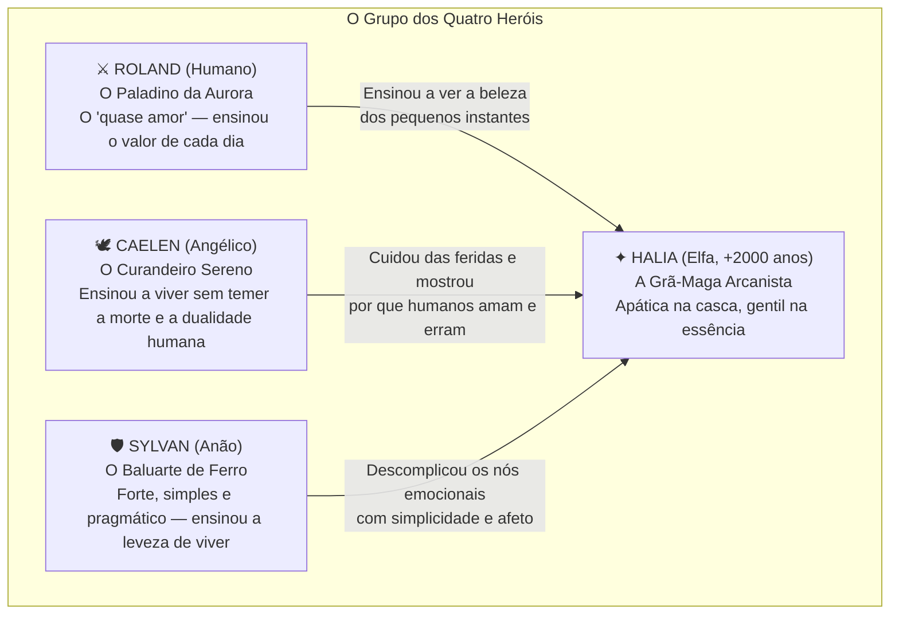

# ✦ BÍBLIA NARRATIVA, ROTEIRO COMPLETO E GUIA DE DESIGN DE FASES — OBLIVIUM ✦

> *"O mundo não era cinzento. Foram os meus olhos que escolheram esquecer como doía olhar para a primavera."*  
> — **Halia, a Grã-Maga**

**Documento Mestre de História, Direção Emocional, Diálogos e Arquitetura de Cenários (Prólogo + 7 Fases)**  
**Desenvolvedores:** Davi Gomes Suassuna & João Victor Sales de Azevedo Silva  
**Referências Estéticas e Psicológicas:** *Frieren e a Jornada para o Além (Sousou no Frieren)*, *Violet Evergarden*, *Pokémon FireRed / GBA 32-bit Pixel Art*

---

## 📑 SUMÁRIO GERAL DO DOCUMENTO

1. [A Alma de Oblivium: Filosofia Narrativa e Psicológica (*Frieren* & *Violet Evergarden*)](#1-a-alma-de-oblivium-filosofia-narrativa-e-psicológica)
2. [Os Quatro Heróis da Travessia Original e a Tragédia do Castelo](#2-os-quatro-heróis-da-travessia-original-e-a-tragédia-do-castelo)
3. [A Maldição como Crise de Ansiedade, Ancoragem e os 7 Estágios de Cor](#3-a-maldição-como-crise-de-ansiedade-ancoragem-e-os-7-estágios-de-cor)
4. [Direção Musical e Sonoplastia Narrativa (`sounds.md`)](#4-direção-musical-e-sonoplastia-narrativa)
5. [ATO 0 — PRÓLOGO: O Despertar no Cinza (Intro, Cabana, Estrada 1 e Estrada 2)](#5-ato-0--prólogo-o-despertar-no-cinza)
6. [FASE 1: O Refúgio de Oakhaven e o Fogo nos Céus (Memória 2 — Sylvan)](#6-fase-1-o-refúgio-de-oakhaven-e-o-fogo-nos-céus)
7. [FASE 2: O Vale dos Moinhos e as Cinzas da Ambição (Memória 3 — Caelen)](#7-fase-2-o-vale-dos-moinhos-e-as-cinzas-da-ambição)
8. [FASE 3: A Grande Muralha de Ferro — Fronteira dos Continentes (Memória 4 — Roland)](#8-fase-3-a-grande-muralha-de-ferro--fronteira-dos-continentes)
9. [FASE 4: A Desolação do Continente Demônio e o Segredo da Barreira (Memória 5 — Os Quatro)](#9-fase-4-a-desolação-do-continente-demônio-e-o-segredo-da-barreira)
10. [FASE 5: Kar'Vash em Ruínas — O Destacamento Avançado e a Quase-Morte (Memória 6)](#10-fase-5-karvash-em-ruínas--o-destacamento-avançado-e-a-quase-morte)
11. [FASE 6: O Castelo do Rei Demônio — Os Três Túmulos e o Confronto Interior (Memória 7)](#11-fase-6-o-castelo-do-rei-demônio--os-três-túmulos-e-o-confronto-interior)
12. [FASE 7: O Campo de Flores Eternas — Epílogo e A Cura (100% de Cor)](#12-fase-7-o-campo-de-flores-eternas--epílogo-e-a-cura)
13. [Catálogos Mestres de Produção: O Gato Patusco (1/7 a 7/7), Arquitetura Modular de JSONs e Checklist de Sprites](#13-catálogos-mestres-de-produção)

---

## 1. A Alma de Oblivium: Filosofia Narrativa e Psicológica

**Oblivium** não é uma história convencional sobre uma heroína reunindo forças para derrotar o mal supremo. **O mal supremo já foi derrotado.** O Rei Demônio já tombou, os exércitos já recuaram, e o mundo já foi salvo. *Oblivium* é uma história sobre o **"depois"** — sobre o que resta de quem sobreviveu quando o barulho das espadas cessa e o silêncio chega.

A construção emocional do jogo apoia-se em dois pilares fundamentais da narrativa contemplativa contemporânea:

### 1.1. O Tempo da Elfa Imortal e a Evitação Afetiva (*Sousou no Frieren*)
Halia é uma elfa que já caminhou pelo mundo por **mais de 2.000 anos**. Para alguém cuja existência atravessa eras como quem atravessa estações do ano, a vida dos mortais parece apenas um sopro rápido.
- **A Procrastinação Afetiva e a Ilusão do Tempo Infinito:** Durante os anos em que viajou ao lado de seus três companheiros (**Roland**, **Caelen** e **Sylvan**) rumo ao Castelo do Rei Demônio, Halia frequentemente manteve uma postura reservada e contida. Ela acreditava, inconscientemente, que sempre haveria outro amanhã para perguntar sobre o passado deles, para agradecer um gesto de cuidado ou para confessar o que sentia.
- **A Narrativa dos Detalhes:** Em *Oblivium*, a grandeza da história não mora nos golpes apocalípticos, mas nas **minúcias cotidianas**: o cheiro de raízes de gengibre fervendo numa chaleira de ferro; o hábito de limpar o musgo de uma estátua esquecida; um grimório antigo que não ensina a destruir exércitos, mas apenas a fazer desabrochar flores silvestres ou aquecer as mãos num dia de geada.
- **O Tempo como Textura (A Lentidão como Escuta):** Ao refazer o caminho de sua antiga jornada sem suas memórias, Halia é forçada a desacelerar. Ela passa pelas vilas e fortalezas que seu grupo salvou anos atrás e escuta dos moradores comuns como pequenos atos de Roland, Caelen, Sylvan e dela mesma mudaram destinos inteiros.

### 1.2. Da Anestesia à Empatia: Cartas, Promessas e Vozes que Ficaram (*Violet Evergarden*)
Quando o jogador assume o controle de Halia na cabana inicial, ela encontra-se em estado de **anestesia emocional**. Sem suas memórias e vendo o mundo em preto e branco absoluto (`0% de saturação`), ela fala de forma seca, direta e quase mecânica — como uma ferramenta arcana de guerra que perdeu sua função após o fim do conflito.
- **O Aprendizado da Empatia através do Outro:** Assim como Violet Evergarden aprende o significado de *"Eu te amo"* escrevendo cartas para pessoas enlutadas, Halia reconstrói sua própria humanidade nas **Missões Secundárias e Encontros de Cada Fase**.
- **Missões com Alma:** Nenhuma missão em *Oblivium* existe apenas para preencher tempo ("mate X monstros"). Cada pedido de um NPC é um fragmento da condição humana: uma carta inacabada de um ferreiro para o filho que foi para a fronteira; um relicário deixado por um jovem que desertou por medo; o chá preparado por uma curandeira para aliviar a dor de quem ficou. Ao ajudar os outros a darem voz à própria saudade, Halia destrava a capacidade de encarar o seu próprio luto.

---

## 2. Os Quatro Heróis da Travessia Original e a Tragédia do Castelo

Antes do esquecimento cinzento, quatro nomes atravessaram os continentes lado a lado. Eles não eram deuses invencíveis; eram quatro almas muito diferentes que encontraram família umas nas outras.



### 2.1. Halia — A Grã-Maga do Crepúsculo (Protagonista)
- **Raça e Idade:** Elfa ancestral (+2.000 anos).
- **Aparência:** 1,70m, pele clara com sardas suaves nas bochechas, olhos verdes como jade (que no início parecem cinzentos pelo filtro da maldição), cabelos castanho-escuros presos em rabo de cavalo. Veste botas de couro gastas pela estrada, saia verde sob sobretudo de mago, blusa de manga comprida, colete de couro marrom, bolsa de carteiro a tiracolo e seu Cajado de Espinheiro.
- **Traços Humanos e Manias (Gatilhos de Personalidade no Jogo):**
  - **Paixão por Gengibre e Raízes:** Halia adora o cheiro e o ardor suave do gengibre, raízes doces e tubérculos assados. Sempre que encontra gengibre no mundo, sua postura rígida amolece por um instante.
  - **Intolerância à Desorganização:** Séculos de estudo arcano deixaram-na impaciente com bagunça. Livros tortos em uma estante, ferramentas espalhadas ou caixas desalinhadas provocam pequenos comentários internos irritados.
  - **Acumuladora de Grimórios e Péssima com Dinheiro:** Ela ama a magia pelo que a magia tem de belo, não apenas pelo poder bélico. Se vir um tomo raro ou um feitiço curioso em uma barraca, gasta suas moedas sem pensar duas vezes.
  - **Odeia Cosquinha:** Tem extrema sensibilidade física quando pega de surpresa — algo que seus amigos usavam para quebrar sua cara fechada nos acampamentos.

### 2.2. Roland — O Paladino da Aurora (Humano)
- **Papel no Grupo:** Paladino e líder de vanguarda.
- **Quem ele era:** Um humano de sorriso calmo, armadura marcada por dezenas de combates e olhar atento para tudo o que os outros ignoravam na beira da estrada.
- **O Vínculo com Halia (O "Quase Amor"):** Para Halia, Roland foi a pessoa que mudou para sempre sua percepção da existência. Quando Halia dizia que *"dez dias de caminhada não são nada perto de um século"*, Roland parava na estrada, colhia uma flor azul do campo ou apontava para a cor das nuvens ao entardecer e respondia: *"Para mim, Halia, o sol de hoje nunca mais vai se pôr do mesmo jeito. E eu fico feliz de estar vendo ele com você."*
- **O Legado em Halia:** Foi um amor que não precisou — ou não teve tempo — de ser consumado em promessas formais antes do fim, tornando a saudade dele ainda mais funda e delicada. Ele ensinou a uma elfa imortal que a brevidade da vida humana não a torna insignificante; pelo contrário, é o que torna cada dia único e sagrado.

### 2.3. Caelen — O Curandeiro das Asas Cinzentas (Angélico)
- **Papel no Grupo:** Sacerdote, curandeiro e conselheiro espiritual.
- **Quem ele era:** Um ser de linhagem angélica, voz mansa e mãos sempre manchadas de ervas medicinais e fuligem das batalhas. Foi um amigo leal que costurou e curou as feridas de todos ao longo da guerra.
- **O Vínculo com Halia:** Halia sempre viu o mundo através da lógica da mana e das leis arcanas, sem se apegar a dogmas religiosos. Caelen jamais tentou convertê-la; em vez disso, conversava com ela sob as estrelas sobre a alma dos mortais. Ele lhe ensinou duas lições que ecoam por todo o jogo:
  1. **Não temer a morte:** *"Temer o fim só nos impede de caminhar enquanto estamos vivos, Halia. A gente vive ignorando que a morte vem, não por tolice, mas por coragem."*
  2. **A Dualidade Humana:** Quando Halia não entendia como humanos podiam trair e saquear uns aos outros mesmo durante uma guerra contra demônios, Caelen explicava com serenidade por que a liberdade mortal gera tanto os seres mais vis quanto os mais sublimes.

### 2.4. Sylvan — O Baluarte da Montanha (Anão)
- **Papel no Grupo:** Tanque, escudo da linha de frente e mestre de forja de acampamento.
- **Quem ele era:** Um anão largo de ombros, barba trançada com anéis de bronze, escudo colossal nas costas e um coração imenso escondido atrás de um jeito direto e rústico.
- **O Vínculo com Halia:** Enquanto Halia costumava complicar seus próprios sentimentos em labirintos de culpa ou orgulho élfico, Sylvan era a voz da terra firme. Com sua simplicidade e pragmatismo gentil, ele ouvia os dilemas mais tortuosos de Halia enquanto assava raízes na fogueira e resolvia tudo em uma única frase: *"Se você se importa com eles, garota, então fique perto. Não precisa de um tratado de mil páginas pra saber onde o pé quer pisar."* Ele ensinou Halia a viver de maneira mais leve.

### 2.5. A Queda no Castelo do Rei Demônio (A Verdade Oculta)
Quando os quatro finalmente alcançaram a Sala do Trono do Castelo do Rei Demônio, o poder do tirano superava tudo o que os relatórios militares previam. A batalha foi brutal e exaustiva:
1. **Sylvan** foi o primeiro a se plantar como uma rocha viva diante do golpe cataclísmico que destruiria o grupo, segurando a lâmina do Rei Demônio com o próprio corpo e rachando a couraça do tirano antes de tombar.
2. **Caelen** manteve Halia e Roland de pé além do limite humano, transferindo sua própria força vital e luz sagrada para conter a miasma abissal até suas asas se desfazerem em cinzas luminosas.
3. **Roland**, já mortalmente ferido, avançou num último ímpeto ao lado de Halia, cravando sua espada no núcleo defensivo do Rei Demônio para abrir a única fraqueza possível — olhando para trás com um último sorriso sereno para que ela disparasse.
4. **Halia**, em lágrimas, canalizou toda a mana do continente e aniquilou o Rei Demônio.

Porém, em seu último suspiro de ódio, o Rei Demônio conjurou a **Maldição Ancestral de Oblivium** contra a mente de Halia. O feitiço encontrou uma alma devastada: ajoelhada no salão silencioso, cercada pelos corpos frios de Sylvan, Caelen e Roland, a dor da culpa da sobrevivente era tão insuportável que a própria mente de Halia **abriu as portas para o esquecimento**. O mundo perdeu as cores, os nomes desapareceram, e ela regressou sozinha para sua cabana na floresta, presa num inverno interior onde nada mais podia doer.

---

## 3. A Maldição como Crise de Ansiedade, Ancoragem e os 7 Estágios de Cor

> [!IMPORTANT]
> **A Maldição na Gameplay e na Narrativa:**  
> A Maldição de Oblivium não é um monstro comum vagando pelo mundo: ela é a **somatização do trauma, do luto não elaborado e da culpa da sobrevivente**, manifestando-se fisicamente em Halia como **Crises de Ansiedade e Ataques de Pânico** sempre que ela se aproxima de uma verdade enterrada.

### 3.1. Sintomas Audiovisuais da Crise no Jogo
Quando um gatilho traumático é ativado em uma fase:
1. **Visão de Túnel (`EfeitoCriseAnsiedade`):** As bordas da tela escurecem com uma vinheta densa que pulsa no ritmo da falta de ar.
2. **Taquicardia e Abafamento Sonoro:** A trilha musical da fase sofre um corte gradual (*low-pass / fade*) enquanto o som grave e acelerado de batimentos cardíacos descompassados domina o áudio.
3. **Vertigem (Tremor Suave de Câmera):** O cenário oscila sutilmente, transmitindo tontura e perda de chão.
4. **Pensamentos Intrusivos (A Voz da Maldição):** Uma versão distorcida da própria voz de Halia sussurra frases que tentam convencê-la a recuar para a apatia:
   - *"O ar acabou... você sente? Se der mais um passo, vai sufocar."*
   - *"Três túmulos ficaram para trás por sua causa. Por que finge que pode salvar alguém agora?"*
   - *"Volte para o silêncio. O cinza é calmo. No cinza, ninguém morre."*

### 3.2. A Mecânica de Ancoragem Sensorial (Vencendo a Crise)
Para romper a paralisia e recuperar o controle da respiração e da magia, Halia não usa força bruta — ela usa **Ancoragem Sensorial (*Grounding*)**, conectando seus sentidos ao presente imediato e a uma lição deixada por seus companheiros:
- **Gesto Físico:** Pés firmes no chão, mão direita sobre o peito sentindo o próprio coração desacelerar, e atenção voltada para uma sensação real do ambiente (o calor da forja, o barulho da água no trigo, a frieza sólida da pedra da muralha, o cheiro de gengibre).
- *(Nota Técnica de UI: O Amuleto exibido no canto da tela e na `TelaDespertarMemoria` é estritamente um elemento de interface/HUD que representa a mandala interior das 7 memórias de Halia, nunca um objeto físico segurado na mão).*

### 3.3. Tabela Mestre dos 7 Fragmentos de Memória e Saturação (`FiltroMemoria`)
Esta tabela alinha 100% o motor gráfico (`src/utils/filtro_memoria.py`), a tela cinemática (`src/ui/tela_despertar.py`) e o catálogo de magias (`src/data/grimorio_halia.json`):

| Estágio | Fase / Momento | Saturação (`alpha_cinza`) | Título na `TelaDespertarMemoria` | Memória e Vínculo Restaurado | Feitiço Despertado |
| :---: | :--- | :---: | :--- | :--- | :--- |
| **0** | Prólogo (Início na Cabana e Estrada 1) | **0% Cor** (`alpha: 255`) | *Vazio Absoluto* | Apatia pós-traumática; Halia sabe apenas seu nome e sente um vazio constante no peito. | *Bola de Fogo*, *Pulso de Gravidade*, *Brisa Curativa* (ao abrir o Grimório) |
| **1** | Fim do Prólogo (Estrada 2 — Deslizamento) | **15% Cor** (`alpha: 215`) | **A Centelha Esquecida** | Ao desobstruir o desfiladeiro e defender o Carroceiro das sombras, Halia recorda que suas mãos nasceram para tecer mana. Primeiros tons sépia/quentes surgem. | **Raio Arcano** (`memorias_necessarias: 1`) |
| **2** | Fase 1: O Refúgio de Oakhaven | **30% Cor** (`alpha: 175`) | **O Peso de um Nome** | Diante da Estátua dos Heróis e da investida do Dragão Vermelho *Ignis'Vahr*, Halia recorda **Sylvan**: sua risada alta na taverna e por que juraram proteger os pequenos. | **Impacto Anômalo** (`memorias_necessarias: 2`) |
| **3** | Fase 2: O Vale dos Moinhos | **50% Cor** (`alpha: 130`) | **A Prece nas Águas** | Após libertar os canais tomados por Magos Renegados e Demônios, Halia recorda **Caelen**: suas mãos curando feridos sob a chuva e sua lição sobre a dualidade mortal. | **Escudo Etéreo** (`memorias_necessarias: 3`) |
| **4** | Fase 3: A Grande Muralha de Ferro | **67% Cor** (`alpha: 85`) | **O Pôr do Sol na Fronteira** | No alto das ameias após deter *Valthor*, Halia recorda **Roland**: o entardecer em que ele a fez parar para olhar o sol antes de marcharem para o abismo. | **Vórtice Abissal** (`memorias_necessarias: 4`) |
| **5** | Fase 4: A Desolação Demoníaca | **82% Cor** (`alpha: 45`) | **A Narrativa das Pequenas Coisas** | Ao desfazer a Grande Barreira e dialogar com os demônios dissidentes *Nyxor* e *Soren*, lembra da última fogueira feliz dos quatro juntos e da origem da Maldição. | **Claridade Ancestral** (`memorias_necessarias: 5`) |
| **6** | Fase 5: Kar'Vash em Ruínas | **94% Cor** (`alpha: 15`) | **A Promessa na Quase-Morte** | À beira da morte após proteger o jovem batedor Owen dos Dois Guardas do Castelo, Halia ouve as vozes de Sylvan, Caelen e Roland: *"Viva por nós, Halia."* | **Ressonância dos Três Ecos** |
| **7** | Fase 6: O Castelo do Rei Demônio | **100% Cor** (`alpha: 0`) | **A Totalidade de Halia** | Diante dos três túmulos e após derrotar **A Maldição (Halia Distorcida)**, ela acolhe a dor e a saudade como parte do amor que viveu. O mundo recupera 100% das cores. | **Totalidade Arcana** |
| **Epílogo** | Fase 7: O Campo de Flores Eternas | **100% Cor Plena** | *O Tempo que Permanece* | Sem batalhas. Com o mundo vibrante em 100% de cor, Halia deposita as flores nos três marcos memoriais e encontra a paz genuína. | — |

---

## 4. Direção Musical e Sonoplastia Narrativa (`sounds.md`)

A música em *Oblivium* não é mero pano de fundo: ela funciona como a voz das emoções que Halia ainda não consegue verbalizar. Todas as cenas seguem o catálogo técnico do `AudioManager` (`Oblivium/sounds.md`):

| Arquivo no Código | Referência Musical (*Frieren* OST — Evan Call) | Função Dramática e Momento de Entrada |
| :--- | :--- | :--- |
| `menu_tema.ogg` | *Tema Melancólico Dark Fantasy* | Acompanha a chuva de pétalas no Menu Principal, preparando o jogador para um conto sobre memória e saudade. |
| `cutscene_intro.ogg` | **For 1000 Years** | Toca durante o monólogo inicial na tela escura (`Intro`). Cordas solitárias que traduzem o peso de dois milênios de solidão. |
| `casa_halia.ogg` / `estrada_floresta.ogg` | **Life is Worth Living** | Dedilhado acústico e flauta melancólica, porém acolhedora. Acompanha os passos de Halia na Cabana, nas Estradas e nas explorações pacíficas de Oakhaven e do Vale dos Moinhos. |
| `cutscene_magia.ogg` | **Life and Legacy** | Entra nos momentos de **Flashback**, na **Ancoragem contra a Crise** e na `TelaDespertarMemoria`. É o tema musical de Roland, Caelen e Sylvan voltando à mente de Halia. |
| `combate_comum.ogg` | **Skirmish** | Percussão ágil e cordas tensas para encontros contra Demônios Inferiores, Olhos Espectrais e Magos Renegados. |
| `combate_chefe.ogg` | **Demon's Bane** | Coral solene e orquestração épica para os duelos contra Chefes de Fase (Demônio Superior, Comandante Corrompido, Valthor, Arauto do Vazio e os Gêmeos de Kar'Vash). |
| `combate_dragao.ogg` | **Dragon Smasher** | Metais imponentes e ritmo avassalador exclusivo para o clímax da Fase 1 contra o Dragão Vermelho *Ignis'Vahr* e a Batalha Final contra *A Maldição*. |
| `cutscene_final.ogg` | **Journey Of a Lifetime** | Entra na Fase 7 (*O Campo de Flores Eternas*) quando o mundo atinge 100% de cor e acompanha Halia até o sorriso final e os Créditos. |

**Uso Dramático do Silêncio e Ambiente (`ambience/`):**
- Antes de cada Crise de Ansiedade, a BGM deve reduzir seu volume para `20%`, deixando apenas `vento_noite.ogg` ou `chuva.ogg` até que a ancoragem de Halia traga `cutscene_magia.ogg` (*Life and Legacy*) em um crescendo emocionante.

---

## 5. ATO 0 — PRÓLOGO: O Despertar no Cinza (Intro, Cabana, Estrada 1 e Estrada 2)

> *“Acordar sem saber pelo que se chora é como carregar uma pedra fria no lugar do coração.”*

- **Estágio de Memória:** Inicia no **Estágio 0 (0% de Cor — P&B Absoluto)** → Conclui despertando a **Memória 1 (15% de Cor — *A Centelha Esquecida*)**.
- **Propósito de Design (Tutorial Orgânico):** Ensinar ao jogador a movimentação (`WASD` + `Shift`), a interação com o mundo (`[E]`), o uso do Inventário e Equipamentos (`[TAB]`), o sistema de escolhas de diálogo, a resolução de puzzles com minigames (`Timing` e `Mash`) e o Combate por Turnos (`Atacar`, `Magia`, `Concentrar`, `Itens`).

---

### 5.1. Guia de Cenário e Arquitetura (Os 3 Mapas do Prólogo)

```
==========================================================================================
[MAPA 1: CASA (Cabana de Halia e Jardim do Lago)] (1280x720)
+-----------------------------------+----------------------------------------------------+
|  [Cama Casal]     [Cômoda/Estante]|               [Mata Fechada Norte]                 |
|   (80,105)           (365,105)    |                                                    |
|                                   |          +------------------------+                |
|        [Livro Antigo]             |          |     LAGO SERENO        |   [Floresta    |
|      +------------------+         |          |   (Água + Juncos +     |    Densa       |
|      | TAPETE ORNAMENTAL|         |          |    Pedras Naturais)    |    Intrans-    |
|      |   (Halia acorda) |         |          +------------------------+    ponível]    |
|      +------------------+         |                                                    |
|   [Bolsa Moedas]  [Cajado]        |                                                    |
+--------------[PORTA]--------------+----------------------------------------------------+
                  |  Trilha
                  +=========> [ESTRADA DE TERRA RÚSTICA PELO JARDIM] =========> Saída Leste
==========================================================================================
[MAPA 2: ESTRADA 1 (O Encontro com o Carroceiro)] (1280x720)
  [Fileira de Árvores Frondosas ao Norte + Folhas de Outono caindo]
  ======================================================================================
  Entrada Oeste (Halia) ---->  [Encontro com o Carroceiro e sua Carroça (x=900)]
  ======================================================================================
  [Fileira de Árvores ao Sul + Arbustos e Flores Desbotadas]
==========================================================================================
[MAPA 3: ESTRADA 2 (O Desfiladeiro do Deslizamento)] (1280x720)
  [Árvores Tombadas e Troncos Partidos]                        [ROCHAS DO DESLIZAMENTO]
  =================================================================== [X][X][X] =========
  [Carroceiro (x=200)]   [Poças d'água animadas]    [Halia (x=980)]   [X][X] (Bloqueio)
  =================================================================== [X][X][X] =========
==========================================================================================
```

---

### 5.2. Diagnóstico e Revisão da História e Diálogos do Prólogo

Ao revisar os textos antigos de `src/data/dialogos.json` e `src/ui/intro.py`, corrigimos quatro problemas estruturais:
1. **Correção Geográfica ("Capital" → "Oakhaven"):** Antes, o Carroceiro dizia estar indo para a *"Capital"* e mencionava *"anciões no Santuário da Capital"*, contradizendo a Fase 1 e o `missoes.json` (*O Refúgio de Oakhaven*). Agora, toda a conversa aponta coerentemente para a **vila de Oakhaven**, onde fica a antiga estátua erguida após a guerra e onde vive o **Ancião Aldous**.
2. **Eliminação de Lusitanismos (PT-PT → PT-BR Poético):** Expressões como *"ao teu redor"*, *"Lembra-te do teu nome"*, *"Está a arder"*, *"focar-me"* e *"Precisamos de dar um jeito"* foram integralmente reescritas em Português do Brasil natural, melancólico e literário.
3. **Transformação das Opções do Carroceiro (De "Filler" para *Frieren* / *Violet Evergarden*):**
   - As antigas perguntas desconexas (*"Qual o seu animal favorito?"*, *"Você gosta de cantar?"*, *"Você tem um lanche na carroça?"*) foram substituídas por conversas que revelam a **personalidade humana de Halia** e o **tema da passagem do tempo**:
     - Quando Halia pergunta sobre o que ele carrega na carroça, ela sente o cheiro de **raízes de gengibre** e percebe, surpresa, que seu corpo lembra de gostar daquilo mesmo sem a mente lembrar o porquê.
     - Quando falam sobre a estrada e o cavalo (*Trovão*), o Carroceiro comenta como a vida humana é curta e como seu avô viu os Quatro Heróis passarem por aquela mesma trilha décadas atrás — gerando em Halia o primeiro choque silencioso sobre o tempo que passou.
     - Em vez de o Carroceiro declarar secamente *"Você é a elfa que matou o Rei Demônio!"*, ele a reconhece pelos olhos verdes de jade e pelo cajado de espinheiro como a maga das histórias de seu avô, contando que em **Oakhaven** há um monumento de pedra dedicado a ela e aos três companheiros que não voltaram.

---

### 5.3. Roteiro Completo e Diálogos Revisados do Prólogo

#### CENA 1: A Introdução (`src/ui/intro.py` — Ao som de `cutscene_intro.ogg` / *For 1000 Years*)
*(Fundo em Carvão Profundo, pétalas cinzentas caindo suavemente, flor botânica no topo)*
1. `"Eu me sinto tão... diferente, tão vazia..."`
2. `"Já faz quanto tempo? Quanto desde a última vez que senti o mundo como devia?"`
3. `"Tudo perdeu suas cores... sua beleza e até seu significado..."`
4. `"Mas sinto que as coisas não deveriam ser assim... Não posso deixar este mundo cinza para sempre."`
5. `"Preciso lembrar de tudo."`

---

#### CENA 2: O Despertar na Cabana (`MapaCasa` — Ao som de `casa_halia.ogg` / *Life is Worth Living* + `lareira.ogg`)
- **Dinâmica e Gatilhos de Humanidade:**
  - Halia desperta de pé ao lado do tapete central de sua cabana silenciosa. Tudo está em escala de cinza (`0% de cor`).
  - Se tentar abrir a porta antes de pegar seus pertences (`porta_trancada`):
    - **Pensamento de Halia:** *"Ainda não peguei minhas coisas. A casa já está silenciosa demais... não posso sair daqui de mãos vazias."*
  - **Coleta dos 3 Itens Fundamentais:**
    1. **Bolsa de Moedas (`item_moedas`):** *"Você encontrou a Bolsa de Moedas com 50 moedas de prata (5 moedas de ouro)."* (Gatilho interno: Halia tem a vaga impressão de que nunca soube economizar muito bem).
    2. **Cajado de Espinheiro (`item_cajado`):** *"Você empunhou o Cajado de Espinheiro. A madeira gasta encaixa-se nos seus dedos como se conhecesse o formato da sua mão."*
    3. **O Livro Antigo (`item_livro`):** *"Você recolheu o Livro Antigo contendo encantamentos arcanos esquecidos."*
  - **Abrindo a Porta (`porta_abriu`):**
    - **Halia:** *"Pronto, estou com tudo. O trinco cedeu."*
    - **Sistema:** *"A porta está aberta. Saia pelo jardim e siga pela pequena estrada de terra."*
  - **Trancando a Porta (`fechar_porta`):**
    - **Pensamento de Halia:** *"Porta trancada. Não sei por que ainda tranco uma casa onde ninguém me visita... Agora devo seguir pela estrada de terra."*
    - **Sistema:** *"Siga pela pequena estrada de terra através do jardim até a saída leste."*

---

#### CENA 3: A Estrada Rural e o Carroceiro (`MapaEstrada` — `estrada_floresta.ogg`)
- **Entrada na Estrada 1 (`entrada_estrada1`):**
  - **Halia:** *"Que vento frio... Até as folhas que caem parecem feitas de cinza e chumbo."*
  - **Pensamento de Halia:** *"Aquele viajante com a carroça disse que passaria por esta estrada ao amanhecer. Ele deve estar vindo pelo leste."*
  - **Sistema:** *"Objetivo: Siga para a direita ao longo da estrada para encontrar o carroceiro."*
- **Avistando a Carroça (`avistar_carroceiro`):**
  - **Pensamento de Halia:** *"Ouço o ranger de rodas na terra batida... É a carroça dele."*
- **Árvore de Diálogo Completa do Carroceiro (`hub_carroceiro`):**
  - **Cumprimento Inicial:**
    - **Carroceiro:** *"Ah, finalmente nos encontramos! Perdoe a demora, senhorita. A trilha até a sua cabana quase sumiu debaixo do mato."*
  - **Menu Principal (`Sobre o que deseja conversar?`):**
    1. **`[sobre_mundo]` "O mundo sempre foi tão cinza assim?"**
       - **Carroceiro:** *"Cinza? Ora, no inverno até que sim, mas estamos no fim da primavera! A relva está verde e as flores do campo abriram ontem. Não entendi o que quis dizer."*
       - **Pensamento:** *"A primavera já chegou?... Então o inverno ficou preso apenas nos meus olhos."*
    2. **`[criticar_demora]` "Suas caixas na carroça estão todas tortas..."** *(Gatilho de personalidade: impaciência com bagunça)*
       - **Carroceiro:** *"Eh?! Me perdoe! A estrada está cheia de buracos e os sacos acabaram revirando... (Ele tenta ajeitar um caixote sem jeito)."*
       - **Pensamento:** *"Por que me incomodei tanto com caixas desalinhadas?... É um hábito antigo que não consigo controlar."*
    3. **`[sobre_passado]` "Você parece me conhecer. Quem sou eu?"**
       - **Carroceiro:** *"Pelos deuses, os boatos eram verdadeiros... Você realmente esqueceu. Esses olhos verdes de jade e esse cajado são da Grã-Maga que enfrentou o Rei Demônio."*
       - **Pensamento:** *"Grã-Maga?... Essas palavras parecem pertencer a outra pessoa. Preciso saber mais."*
       - **Submenu Passado (`O que deseja perguntar sobre o passado?`):**
         - **`[passado_rei_demonio]` "O que aconteceu na batalha contra o Rei Demônio?"**
           - **Carroceiro:** *"Meu avô contava que o céu ardeu por três dias no norte. Você não foi sozinha... havia três companheiros com você. Mas apenas a senhorita retornou daquele castelo."*
         - **`[passado_ancioes]` "Para onde estamos indo? Alguém lá pode me ajudar?"**
           - **Carroceiro:** *"Estou indo para o Refúgio de Oakhaven. O Ancião Aldous guarda as crônicas da guerra, e há uma estátua sua e de seus amigos na praça da vila."*
         - **`[passado_voltar]` "« Voltar aos outros assuntos"**
    4. **`[sobre_clima]` "O ar parece pesado hoje..."**
       - **Carroceiro:** *"Pelo menos a chuva deu trégua. Quando a neblina desce da serra, até os pássaros ficam quietos."*
    5. **`[perguntar_lanche]` "Que cheiro doce e picante é esse nos seus sacos?"** *(Gatilho de personalidade: amor por gengibre)*
       - **Carroceiro:** *"Tem bom olfato! São raízes frescas de gengibre que levo para a Curandeira Elara em Oakhaven. Tome, pode ficar com um pedaço para mastigar no caminho."*
       - **Pensamento:** *"Gengibre... O ardor morno na língua fez meu peito aquecer por um segundo. Eu sempre gostei disso."*
    6. **`[sobre_estradas]` "Por que você anda escoltando a estrada com tanto receio?"**
       - **Carroceiro:** *"Mesmo após a queda do tirano, sombras desgarradas e saqueadores ainda rondam os vales. Sem os antigos heróis nas estradas, todo cuidado é pouco."*
    7. **`[sobre_animal]` "Seu cavalo parece cansado. Há quanto tempo viajam juntos?"** *(Gatilho Frieren: passagem do tempo humano)*
       - **Carroceiro:** *"O Trovão já está ficando velho, coitado. Doze anos comigo... Para a senhorita deve parecer um piscar de olhos, mas para nós dois foi uma vida inteira."*
       - **Pensamento:** *"Doze anos... Uma vida inteira. Por que sinto um aperto tão doloroso ao ouvir isso?"*
    8. **`[sobre_cantar]` "Por que você estava cantarolando antes de parar?"**
       - **Carroceiro:** *"Ah, é uma velha canção de marcha dos soldados da Muralha. Dizem que um guerreiro anão e um paladino costumavam cantá-la nas tavernas para espantar o medo."*
       - **Pensamento:** *"Uma voz grave desafinada e uma risada clara... Quase pude escutá-las junto com o vento."*
    9. **`[prosseguir]` "Estou pronta. Podemos partir para Oakhaven."**
       - **Carroceiro:** *"Segure-se firme e suba na carroça. O caminho até a vila de Oakhaven corta o desfiladeiro da serra."*
       - **Sistema:** *"Iniciando viagem rumo ao Refúgio de Oakhaven..."* (`evento: "prosseguir"`)

---

#### CENA 4: O Deslizamento, O Eco do Passado e o Primeiro Combate (`MapaEstrada2`)
- **Parada Abrupta (`entrada_estrada2`):**
  - **Narrador:** *"Algumas horas de viagem depois... A carroça para abruptamente no desfiladeiro."*
  - **Carroceiro:** *"Pelos deuses... Um deslizamento de terra! Olhe o tamanho daquelas rochas fechando a estrada para Oakhaven."*
  - **Pensamento de Halia:** *"Nenhuma carroça passará por cima disso. Preciso examinar essas pedras de perto."*
- **Investigando o Bloqueio (`investigar_pedras`):**
  - **Halia:** *"São toneladas de granito bruto... Força física não vai mover uma única lasca."*
  - **Opção:** `Analisar as pedras caídas detalhadamente` (`evento: "analisar_pedras"`)
- **O Flashback da Magia (`flashback_magia` — Ao som de `cutscene_magia.ogg` / *Life and Legacy*):**
  1. **Narrador:** *"Ao apoiar a palma da mão na rocha fria, o som do vento ao seu redor silencia por completo..."*
  2. **Eco do Passado:** *"Halia... Não deixe o frio apagar o que você é. Suas mãos não foram feitas apenas para o luto."*
  3. **Pensamento:** *"Meu peito... está queimando. Consigo sentir os fios invisíveis de mana correndo entre os meus dedos... Eu sei conjurar magia!"*
  4. **Sistema:** *"Sua ligação com a mana ancestral despertou. O Grimório responde ao seu chamado."*
- **A Escolha da Magia e os Minigames (`escolha_magias`):**
  - **Opção A — `Conjurar Magia de Fogo (Puzzle de Mira)` (`escolha_fogo`):**
    - **Pensamento:** *"Se eu alinhar os três selos de ignição, posso concentrar uma esfera ígnea e pulverizar este bloqueio!"*
    - **Sucesso (`pos_fogo`):** A Bola de Fogo estilhaça as rochas deixando brasas crepitantes no chão. O estrondo atrai **2 Demônios Inferiores** (`demonio_inferior`) das sombras!
  - **Opção B — `Conjurar Magia de Levitação (Puzzle de Concentração)` (`escolha_levitar`):**
    - **Pensamento:** *"Se eu sustentar o pulso gravitacional ao redor das fendas, posso erguer estas rochas e assentá-las nas margens da estrada."*
    - **Sucesso (`pos_levitar`):** Com um gesto solene, as rochas flutuam para as bordas. Porém, a densa emanação de mana pura atrai **1 Demônio Superior** (`demonio_superior`)!
- **Pós-Combate e o Despertar da Memória 1 (`pos_combate_vitoria` & `carroceiro_estrada2`):**
  - **Carroceiro:** *"Incrível, Halia! Você dissipou aquelas criaturas como nas lendas antigas. O caminho está livre."*
  - **Diálogo sobre os Monstros (`falar_batalha` — *"Essas criaturas... o que eram elas?"*):**
    - **Carroceiro:** *"Resquícios da névoa abissal. Mesmo sem seu rei, sombras famintas ainda farejam o rastro de grande poder mágico pelas estradas."*
    - **Halia:** *"Elas foram atraídas pela minha própria mana... Preciso ter cuidado."*
  - **Partida para Oakhaven (`seguir_capital` — *"Subir na carroça e seguir para Oakhaven"*):**
    - **Carroceiro:** *"Excelente! Suba na carroça, os telhados de Oakhaven já estão logo depois desta colina."*
    - **Narrador:** *"Com as ameaças derrotadas e o desfiladeiro aberto, Halia sobe na carroça e a viagem prossegue..."*
    - **Pensamento:** *"Olho para a palma das minhas mãos e ainda sinto o calor da magia pulsando... Pela primeira vez em muito tempo, o cinza parece ceder um pouco."*
  - **Gatilho Cinemático:** Dispara `TelaDespertarMemoria` (**Estágio 1 de 7 — *A Centelha Esquecida***), liberando o feitiço **Raio Arcano** e elevando a saturação do mundo para **15% de Cor**.


---

## 6. FASE 1: O Refúgio de Oakhaven e o Fogo nos Céus (Memória 2 — Sylvan)

> *“Para os livros de história, nós salvamos um continente. Para o velho ferreiro desta vila, o meu amigo anão foi apenas o sujeito barulhento que consertou o portão da oficina dele sem cobrar um único cobre.”*

- **Estágio de Memória e Cor:** Inicia em **15% de Cor (Memória 1)** → Conclui despertando a **Memória 2 (30% de Cor — *O Peso de um Nome*)**.
- **Companheiro em Foco:** **Sylvan, o Baluarte da Montanha (Anão)** — A simplicidade do dever, o riso que espantava o medo e o cuidado prático pelas pessoas comuns.
- **Trilha Sonora (`sounds.md`):**
  - Exploração da Vila: `estrada_floresta.ogg` (*Life is Worth Living*) + `lareira.ogg` próximo à Forja.
  - Diante da Estátua dos Heróis e Flashback: `cutscene_magia.ogg` (*Life and Legacy*).
  - Batalha contra o Dragão Vermelho *Ignis'Vahr*: `combate_dragao.ogg` (*Dragon Smasher*).
- **Recompensa Arcana:** Desbloqueia **Impacto Anômalo** (`memorias_necessarias: 2`).

---

### 6.1. Guia de Desenho do Cenário e Planta Baixa (Oakhaven)

Oakhaven é o primeiro grande centro habitado do jogo, inspirado nosQuadros 2, 3 e 4 do [Storyboard](file:///c:/Users/jvsal/OneDrive/Desktop/Arquivos%20de%20Programa%C3%A7%C3%A3o/Projeto-de-POO---Oblivium-main/Projeto-de-POO---Oblivium/Storyboard/Storyboard_compressed.pdf). A vila parece inicialmente desbotada (apenas 15% de saturação quente), mas sua arquitetura é acolhedora e viva.

```
====================================================================================================
[PLANTA BAIXA DE OAKHAVEN — GUIA DE MONTAGEM DE CENÁRIO]
                    [SAÍDA NORTE: COLINA DO SANTUÁRIO / PLATAFORMA DO DRAGÃO]
                           ▲  (Escadaria de Pedra: 11_Escadas_Pontes_e_Acessos)
+--------------------------+-------------------------------------------+---------------------------+
| [NOROESTE: TAVERNA DO    |       [NORTE DA PRAÇA: TORRE DO SINO]     | [NORDESTE: PALIÇADA E     |
|  SALÃO COMUNAL]          |       - Guarda Doran vigia o horizonte    |  POSTO DA GUARDA]         |
| - Parede_Tipo_01 +       |                                           | - Cercas e Estandartes    |
|   Telhado grande         |       +---------------------------+       | - Saída para a Orla da    |
| - Mesas externas e barris|       |  monumentos / ESTÁTUA DOS |       |   Floresta (Ervas/Ronda)  |
|                          |       |   QUATRO HERÓIS (Centro)  |       |                           |
+--------------------------+       |   [Halia, Roland,         |       +---------------------------+
|                                  |    Caelen e Sylvan]       |                                   |
|   [Caminho de Pedra Cinza]       |   + Chafariz de Pedra     |         [LESTE: FORJA DE TORVALD] |
|                                  +---------------------------+         - Parede_Tipo_02 (Tijolo) |
|                                        [Ancião Aldous]                 - Bigorna, Braseiro aceso |
+--------------------------+                                             - Caixas ao lado da forja:|
| [SUDOESTE: BOTÂNICA E    |                                               🐱 PATUSCO (1/7)        |
|  ENFERMARIA DE ELARA]    |                                             - [Ferreiro Torvald]      |
| - Canteiros de flores e  |                                                                       |
|   raízes de gengibre     |             [PRAÇA CENTRAL DE CALÇAMENTO]                             |
| - [Curandeira Elara]     |                                                                       |
+--------------------------+-------------------+-----------------------+---------------------------+
                                               |
                                  [SUL: ENTRADA DA VILA]
                           [Carroça estacionada + Carroceiro]
====================================================================================================
```

#### Especificações Técnicas para Desenho (`GUIA_MONTAGEM_CENARIOS.md`):
- **Camada 0 (`Ground_Base`):** Grama (`02_Pisos_Externos/01_Grama_Verde`) nas bordas e Calçamento de Pedra (`02_Pedra_Cinza`) formando a Praça Central e os caminhos.
- **Camada 1 (`Ground_Details`):** Penhasco elevado ao Norte (`09_Elevacoes_e_Penhascos/01_Penhascos_Terra_e_Grama`) levando à Colina Fortificada onde *Ignis'Vahr* pousará.
- **Camada 3 (`Walls_Structures`):** Casas de `assets/cenario/vila/Casas/` e `Lojas/`, com **colisão 2.5D apenas nos 16px inferiores do rodapé**.
- **Camada 4 (`Entities_Props` com Y-Sort):**
  - **Estátua dos Quatro Heróis** (`vila/Props/Monumentos/`): O ponto focal da praça (Quadro 2 do Storyboard). Coberta por musgo e poeira do tempo.
  - **Forja de Torvald:** Usa `efeitos/fogo/chama_braseiro_medio` na fornalha externa.
  - **Patusco (Easter Egg 1/7):** Sprite `assets/animais/gato/` dormindo enrodilhado sobre as caixas de madeira ao lado da Forja de Torvald.

---

### 6.2. Gatilhos de Humanidade de Halia em Oakhaven ("A Narrativa dos Detalhes")

1. **O Canteiro de Gengibre na Botânica de Elara:**
   - Ao interagir `[E]` com o vaso de raízes ao lado da porta de Elara:
   - **Pensamento de Halia:** *"Raízes de gengibre-da-serra plantadas em terra úmida... Estão alinhadas por tamanho. Quem cuida deste canteiro tem bom gosto e mãos caprichosas."*
2. **A Bancada de Ferramentas de Torvald (Impaciência com Bagunça):**
   - Ao interagir `[E]` com a mesa de tenazes e martelos espalhados na forja:
   - **Halia:** *"(Sem perceber, Halia passa um minuto inteiro alinhando os martelos do maior para o menor sobre a bancada)."*
   - **Torvald:** *"Ei, senhorita! Assim eu não vou achar nada na minha própria bagunça!"*
   - **Halia:** *"Agora estão na ordem correta de peso e têmpera. De nada."*
3. **A Estátua Coberta de Musgo (Homenagem direta a *Frieren*):**
   - Ao examinar a estátua antes de falar com os moradores, Halia vê quatro figuras de pedra: uma maga elfa, um paladino humano, um clérigo angélico e um guerreiro anão. Os rostos na pedra estão gastos pela chuva.
   - Halia usa um pequeno sopro de mana para limpar as folhas secas e o musgo do ombro da estátua do anão.

---

### 6.3. Missões Principais e Secundárias da Fase 1

#### ✦ Missão Principal (`missao_boas_vindas`): "O Refúgio de Oakhaven e os Ecos na Pedra"
- **Doador:** Ancião Aldous (na Praça Central).
- **Fluxo Narrativo:**
  1. Ao chegar em Oakhaven, Halia observa a Estátua dos Quatro Heróis e conversa com o **Ancião Aldous**.
  2. Aldous percebe que a Grã-Maga perdeu as memórias da guerra. Em vez de apenas lhe dar um resumo frio, ele pede que ela caminhe pela vila e converse com **Elara** (Botânica/Enfermaria) e **Torvald** (Forja), pois ambos guardam lembranças vivas da passagem do grupo de Halia por Oakhaven anos atrás.
  3. Ao retornar a Aldous após ouvir os moradores, a conexão entre os relatos desperta o primeiro lampejo do rosto de **Sylvan**, exatamente no instante em que os tremores no norte anunciam a descida do Dragão Vermelho.

#### 🌿 Missão Secundária 1 (`missao_ervas_medicinais`): "O Aroma que Não se Esquece"
- **Doadora:** Curandeira Elara (Botânica ao Sudoeste) — *Loja de Poções e Elixires*.
- **História (*Violet Evergarden*):** Elara cuida de Tomas, um velho lenhador que sofre de dores crônicas nos pulmões desde o incêndio da antiga floresta na Grande Guerra. Ela precisa de **3 Ervas Lunares** que crescem na orla nordeste da vila para preparar uma infusão calmante com gengibre.
- **Desfecho Emocional:** Ao entregar as ervas, Elara prepara duas xícaras de chá fumegante de gengibre e erva-lunar e entrega uma a Halia. Quando Halia bebe o primeiro gole quente, ela lembra de uma voz rouca e bem-humorada (Sylvan) dizendo numa noite gelada: *"Beba logo isso, orelhuda! Magia nenhuma esquenta a barriga melhor que raiz fervida!"*
- **Recompensa:** `150 Moedas de Cobre`, `75 XP`, `1x Elixir de Mana Menor` + Desbloqueio da Receita de Infusão Calmante.

#### 📜 Missão Secundária 2: "A Carta Inacabada da Forja"
- **Doador:** Ferreiro Torvald (Forja ao Leste) — *Loja de Equipamentos, Armas e Materiais*.
- **História (*Violet Evergarden*):** Torvald é um homem orgulhoso e calado. Sobre sua bancada há uma folha de pergaminho amarelada, cheia de borrões de carvão. Seu filho, **Kael**, partiu anos atrás para servir como sentinela na **Grande Muralha de Ferro (Fase 3)** inspirado pela coragem do grupo de heróis que passou pela vila. Torvald quer enviar uma carta ao filho, mas suas mãos calejadas de ferreiro tremem e ele não sabe colocar em palavras o quanto sente orgulho e saudade dele.
- **A Intervenção de Halia:**
  - Torvald conta a Halia que, durante a guerra, o anão do grupo (**Sylvan**) passou uma noite inteira naquela forja ajudando-o a reforçar os portões da vila. Enquanto martelava o ferro, Sylvan falou para Torvald: *"Filhos são como aço bom, ferreiro. A gente bate, esquenta no fogo e preocupa, mas uma hora eles têm que ir pro mundo segurar o próprio escudo. Só não deixe ele ir achando que você ficou bravo."*
  - Halia se senta ao lado da bigorna e escreve a carta sob o ditado embargado de Torvald, traduzindo o silêncio teimoso do pai em palavras sinceras: *"O fogo da forja continua aceso para quando seu turno na Muralha terminar."*
- **Conexão Futura:** Halia leva consigo a carta selada (`ItemChave: carta_torvald`) para entregá-la na **Fase 3 (Grande Muralha de Ferro)**.
- **Recompensa:** `200 Moedas de Cobre`, `100 XP`, `Minério Sombrio x2` e desconto permanente na Forja.

#### ⚔ Missão Secundária 3 (`missao_ronda_fronteiras`): "Sombras na Paliçada"
- **Doador:** Guarda Doran (Portão Nordeste).
- **História:** Pequenos batedores abissais (`2x Demônio Inferior`) estão rondando a orla da floresta fugindo do calor anormal que desce das montanhas do norte — o primeiro presságio de que o Dragão Vermelho despertou de seu covil.

---

### 6.4. O Clímax da Fase 1: A Crise do Fogo, *Ignis'Vahr* e a Memória de Sylvan

1. **O Gatilho da Invasão:**
   - Após Halia conversar com Elara e Torvald e retornar para a **Estátua dos Quatro Heróis** junto ao Ancião Aldous, o chão da praça estremece violentamente.
   - O sino da torre começa a dobrar em desespero. Uma sombra imensa engole os telhados de Oakhaven e o céu ao norte se rasga em chamas carmesins: **Ignis'Vahr, o Dragão Vermelho Ancestral**, pousa no platô da Colina Norte, expelindo labaredas que incendeiam as árvores da borda.
2. **A Crise de Ansiedade 1 (O Trauma do Fogo):**
   - O rugido ensurdecedor e o calor das chamas acionam o primeiro **Ataque de Pânico (`EfeitoCriseAnsiedade`)**.
   - A tela escurece nas bordas, o som do sino abafa e o coração de Halia dispara.
   - **Voz da Maldição (Sussurro Intrusivo):**
     - *"Olhe para o fogo, Halia... É igual ao dia em que o salão do trono queimou."*
     - *"O ar está ardendo. Seus pulmões vão fechar. Se você subir aquela escadaria, vai ver todos morrerem de novo."*
     - *"Corra. Esconda-se no cinza."*
3. **A Ancoragem Sensorial de Halia:**
   - Halia cai sobre um joelho nos degraus da praça. Seus olhos pousam na **Estátua de Pedra** logo ao lado — especificamente no escudo de pedra de **Sylvan**, que ela havia limpado minutos antes, e no cheiro de ferro e gengibre em suas roupas.
   - Ela leva a mão direita ao peito, sente o próprio batimento e firma o Cajado de Espinheiro nas lajes:
   - **Halia:** *"Não... Isto não é o Castelo. Sob as minhas botas há pedra fria. Nas minhas mãos ainda há o cheiro do chá da Elara. E atrás de mim estão as pessoas que o Sylvan protegeu."*
4. **A Batalha de Chefe: Dragão Vermelho Ancestral (*Ignis'Vahr*)**
   - **Sprites:** `assets/inimigos/dragao_vermelho/` (`idle`, `attack_01`, `attack_02`, `special`, `hurt`, `dead`).
   - **Música:** `combate_dragao.ogg` (*Dragon Smasher*).
   - **Mecânicas de Turno:**
     - `sopro_de_brasas`: Ataque mágico de Fogo em área que aplica **Queimadura** (DoT).
     - `batida_de_asas`: Rajada física pesada com chance de aplicar **Atordoado**.
     - `escamas_incandescentes`: Buff de resistência física temporária, incentivando o jogador a usar magias arcanas (`Raio Arcano` / `Pulso de Gravidade`) ou `Concentrar -> Defender` antes do sopro.
5. **O Despertar da Memória 2 (30% de Cor — *O Peso de um Nome*):**
   - Em seu último suspiro, *Ignis'Vahr* ergue o pescoço e dispara uma última labareda desesperada na direção da praça onde Aldous e os aldeões estão abrigados.
   - Por puro reflexo, Halia avança um passo à frente, bate a base do cajado no chão — exatamente na mesma postura em que **Sylvan** cravava seu escudo — e projeta uma redoma arcana que dissipa o fogo em fagulhas douradas.
   - **Flashback 2 (`cutscene_magia.ogg` — *Life and Legacy*):**
     - **Narrador:** *"O calor das brasas se desfaz na brisa, e a pedra cinzenta da estátua ganha o brilho quente do bronze antigo..."*
     - **Eco do Passado (Voz de Sylvan):** *"Hahaha! Viu só a cara que o ferreiro fez, Halia? Você fica aí lendo esses livros de mil anos com essa cara de chuva, mas no fundo treme toda quando acha que não vai conseguir proteger todo mundo!"*
     - **Eco do Passado (Voz de Sylvan):** *"Escute aqui, orelhuda: ninguém segura o céu sozinho. Quando o peso ficar grande demais, plante os dois pés no chão e lembre por quem você tá segurando o cajado. É simples assim."*
     - **Pensamento de Halia:** *"Sylvan... Eu lembrei do som da sua risada. Você era tão barulhento, tão teimoso... e tão gentil."*
   - **Gatilho Cinemático:** Abre `TelaDespertarMemoria` (**Estágio 2 de 7 — *O Peso de um Nome***). A saturação sobe para **30% de Cor** (os telhados terracota, o fogo da forja e o verde suave das árvores despertam), e Halia desbloqueia **Impacto Anômalo**.

---

### 6.5. Diálogos Principais de Oakhaven (Trechos-Chave para `dialogos_fase1.json`)

- **Ancião Aldous (Primeiro Encontro diante da Estátua):**
  - **Aldous:** *"Eu reconheceria esse cajado de espinheiro mesmo que mais cem primaveras passassem sobre os meus olhos cansados... Bem-vinda de volta a Oakhaven, Grã-Maga Halia."*
  - **Halia:** *"O senhor me conhece... Mas receio que eu não me lembre do seu nome. Nem do dia em que estávamos nesta pedra."*
  - **Aldous:** *"Então os rumores sobre a névoa do norte eram reais. Não se force a lembrar de tudo de uma só vez, criança. A memória é como água de poço: se você agitar o fundo com pressa, ela só fica mais turva."*
  - **Aldous:** *"Olhe para esta estátua. Para você, ela pode parecer apenas granito mudo. Mas para Elara e para Torvald, as pessoas esculpidas aí deixaram marcas que o tempo não apagou. Converse com eles."*
- **Interação com Patusco na Forja (Easter Egg 1/7):**
  - **Narrador:** *"Um gato rajado e surpreendentemente roliço dorme em cima dos caixotes ao lado da forja, aquecido pelo calor das brasas."*
  - **Halia:** *"(Halia se agacha em silêncio e faz um carinho leve atrás da orelha dele)."*
  - **Patusco:** *"Miau... prrrr."*
  - **Pensamento de Halia:** *"O pelo dele está quentinho... Patusco parece perfeitamente em paz com a sua rotina. (Easter Egg 1/7)"*

---

## 7. FASE 2: O Vale dos Moinhos e as Cinzas da Ambição (Memória 3 — Caelen)

> *“Eu nunca entendi as preces que Caelen sussurrava aos deuses. Mas, vendo até onde o medo leva os homens comuns, finalmente entendo por que ele rezava tanto por eles.”*

- **Estágio de Memória e Cor:** Inicia em **30% de Cor (Memória 2)** → Conclui despertando a **Memória 3 (50% de Cor — *A Prece nas Águas*)**.
- **Companheiro em Foco:** **Caelen, o Curandeiro das Asas Cinzentas (Angélico)** — A compaixão sem ingenuidade, a coragem diante da mortalidade e o olhar sobre a luz e a sombra na alma humana.
- **Trilha Sonora (`sounds.md`):**
  - Exploração do Vale: `estrada_floresta.ogg` (*Life is Worth Living*) + som ambiente de vento no trigo e água corrente.
  - Combates contra Saqueadores/Magos e Demônios: `combate_comum.ogg` (*Skirmish*).
  - Batalha de Chefe no Moinho Central: `combate_chefe.ogg` (*Demon's Bane*).
  - Flashback de Caelen: `cutscene_magia.ogg` (*Life and Legacy*).
- **Recompensa Arcana:** Desbloqueia **Escudo Etéreo** (`memorias_necessarias: 3`).

---

### 7.1. Guia de Desenho do Cenário e Planta Baixa (Vale dos Moinhos)

O Vale dos Moinhos conecta Oakhaven à estrada militar do norte. É uma paisagem bucólica de colinas em degraus, canais de irrigação e campos dourados de trigo que foi ocupada por um bando de **Magos Renegados e Saqueadores** (conforme Página 2 do [Storyboard](file:///c:/Users/jvsal/OneDrive/Desktop/Arquivos%20de%20Programa%C3%A7%C3%A3o/Projeto-de-POO---Oblivium-main/Projeto-de-POO---Oblivium/Storyboard/Storyboard_compressed.pdf): *"Ladrões ou grupos de magos cruéis que estarão pelo caminho infortunando pessoas"*) que fizeram pacto com **Demônios Inferiores** para controlar os estoques de grãos e cobrar pedágio nas pontes.

```
====================================================================================================
[PLANTA BAIXA DO VALE DOS MOINHOS — GUIA DE MONTAGEM DE CENÁRIO]
                      [SAÍDA NORTE: ESTRADA MILITAR RUMO À GRANDE MURALHA]
                                               ▲
+------------------------------+---------------+-----------------------------------+---------------+
| [NOROESTE: MOINHO III        | [CANAL NORTE] | [NORDESTE: PRAÇA DO GRANDE MOINHO | [COMPORTA 3]  |
|  (Colina Alta — Nível 2)]    |   ~~~~Ponte~~~|  CENTRAL (Arena do Chefe Vaelen)] |  (Roda d'água |
| - Comporta 2 bloqueada       |       ~~~     | - Grande Moinho de Vento          |   travada por |
| - Cesta de maçãs nas pás:    |       ~~~     | - Acampamento dos Magos Renegados |   correntes)  |
|   🐱 PATUSCO (2/7)           |       ~~~     |   e Demônio de Assalto            |               |
+------------------------------+       ~~~     +-----------------------------------+---------------+
|      ▲ (Escada de Pedra)             ~~~                      ▲ (Ponte Principal Trancada)       |
| [OESTE: MOINHO I             |   [RIO DO     | [LESTE: CAMPOS DE TRIGO E FENO]                   |
|  (Colina Média — Nível 1)]   |    VALE]      | - Patrulhas de Saqueadores e Demônios Inferiores  |
| - Comporta 1                 |       ~~~     | - Barril caído com o Diário do Aprendiz (Quest)   |
| - Casa da jovem camponesa    |   ~~~~Ponte~~~| - Pequeno altar de pedra de Caelen à beira d'água |
|   Mira (Irmã do Aprendiz)    |       ~~~     |                                                   |
+------------------------------+-------+-------+---------------------------------------------------+
| [SUDOESTE: ABRIGO DO MESTRE BRAM]    |       | [SUDESTE: TENDA DA MERCADORA MAEVE]               |
| - Oficina de carpintaria e moinhos   |       | - Tapetes, tecidos rúnicos, anéis e grimórios     |
| - [Mestre dos Moinhos Bram]          |       | - [Mercadora Maeve] (Loja de Acessórios/Grimórios)|
+--------------------------------------+-------+---------------------------------------------------+
                                           ▲
                               [SUL: ENTRADA VINDA DE OAKHAVEN]
====================================================================================================
```

#### Especificações Técnicas para Desenho (`GUIA_MONTAGEM_CENARIOS.md`):
- **Camada 0 (`Ground_Base`):** Grama (`01_Grama_Verde`), caminhos de Terra (`03_Terra_Marrom`) e o Rio Central (`06_Agua_Azul` com margens autotile).
- **Camada 1 (`Ground_Details`):** Três níveis de colinas escalonadas usando `09_Elevacoes_e_Penhascos/01_Penhascos_Terra_e_Grama`.
- **Camada 2 (`Shadows_Access`):** Escadas de pedra (`11_Escadas_Pontes_e_Acessos/01_Escadas_e_Degraus`) subindo os níveis das colinas e Pontes de Madeira (`02_Pontes_e_Pranchas_Madeira`) cruzando o canal.
- **Patusco (Easter Egg 2/7):** Deitado dentro de uma cesta de maçãs vermelhas encostada na base das pás do Moinho Noroeste.

---

### 7.2. Gatilhos de Humanidade de Halia no Vale dos Moinhos

1. **O Grimório "Inútil" na Tenda de Maeve (Homenagem direta a *Frieren*):**
   - Na loja da Mercadora Maeve, além de anéis e mantos de combate, há um livro empoeirado: *"Grimório Folclórico: Feitiço para Secar Roupas Molhadas com Brisa Morna"*.
   - **Maeve:** *"Ah, esse aí não serve para batalha nenhuma, senhorita. É só um feitiço doméstico antigo que os viajantes usavam depois de pegar chuva."*
   - **Halia (olhos brilhando discretamente):** *"Eu levo. Quanto custa?"*
   - **Pensamento de Halia:** *"Alguém do meu grupo vivia reclamando de caminhar com as botas encharcadas... E outro dizia que os feitiços mais bonitos eram os que não feriam ninguém."*
2. **O Pequeno Altar de Pedra à Beira do Canal:**
   - Um marco simples de pedras empilhadas com uma pena esculpida (símbolo da ordem angélica de Caelen), erguido anos atrás quando o grupo curou uma febre que assolou o vale. Halia não reza — ela apenas tira uma erva daninha que cobria a pena gravada na rocha.

---

### 7.3. Missões Principais e Secundárias da Fase 2

#### ✦ Missão Principal: "O Curso das Águas e as Três Comportas"
- **Doador:** Mestre dos Moinhos Bram (Abrigo Sudoeste).
- **Fluxo e Puzzle Tático:**
  - O bando liderado por **Vaelen (um ex-mago de suporte da guerra que desertou e se aliou a um Demônio Superior de Assalto)** travou as **3 Comportas Hidráulicas** dos moinhos com selos de gelo e correntes para secar o canal inferior e proteger seu acampamento no Moinho Central.
  - Halia precisa subir pelas colinas Oeste e Noroeste, resolver os puzzles elementais nas Comportas 1, 2 e 3 (usando *Bola de Fogo* para derreter as engrenagens congeladas e *Pulso de Gravidade* para girar as rodas d'água emperradas), devolvendo o fluxo de água ao rio e inundando a trincheira externa do Moinho Central para abrir caminho até o chefe.

#### 📜 Missão Secundária 1: "O Diário do Aprendiz Arrependido"
- **Doadora:** Mira, a Jovem Moleira (Moinho I — Oeste).
- **História (*Violet Evergarden* & a Lição de Caelen):** O irmão mais novo de Mira, **Lukas**, era um jovem aprendiz de magia que, apavorado com a miséria pós-guerra, foi aliciado pelo grupo dos Magos Renegados de Vaelen. Mira implora para que Halia descubra o que aconteceu com ele.
- **Descoberta:** Nos campos a leste, Halia encontra uma bolsa caída junto a bandagens manchadas e o **Diário de Lukas**. Nas páginas finais, o rapaz escreveu que se recusou a incendiar o moinho de sua própria vila, ajudou dois camponeses a fugirem em segredo e acabou sendo expulso e ferido pelos próprios comparsas antes de partir em exílio. Há um bilhete dobrado dentro da capa pedindo perdão à irmã.
- **Desfecho Emocional:** Ao ler o bilhete para Mira, Halia reflete sobre o que **Caelen** dizia: os humanos são frágeis e muitas vezes tropeçam no medo, mas mesmo na queda ainda são capazes de escolher um último gesto de bondade.
- **Recompensa:** `250 Moedas de Cobre`, `120 XP`, `Tomo da Brisa Restauradora` (ou `Tecido Rúnico x2`).

#### 🕯 Missão Secundária 2: "Lanternas sobre a Correnteza"
- **Doador:** Mestre Bram.
- **História:** Quando o rio volta a correr após a abertura das comportas, Bram pede a Halia que acenda com uma centelha suave de magia três pequenas lanternas de madeira na margem do canal — uma tradição do vale para guiar a memória daqueles que partiram, iniciada por um "curandeiro de cabelos claros e olhos serenos" (Caelen) que passou por ali anos atrás.

---

### 7.4. O Clímax da Fase 2: A Crise da Dualidade, O Chefe e a Memória de Caelen

1. **A Crise de Ansiedade 2 (O Peso das Escolhas e da Morte):**
   - Ao atravessar a ponte rumo ao Moinho Central, Halia vê os Magos Renegados usando magias que originalmente foram criadas para proteger o reino, agora canalizadas ao lado de um **Demônio de Assalto (`demonio_superior`)**. O barulho rítmico das pás quebradas do moinho soa como passos de uma marcha fúnebre.
   - **Ataque de Pânico (`EfeitoCriseAnsiedade`):**
     - **Voz da Maldição:**
       - *"Olhe para eles, Halia. Caelen deu a vida por este mundo... e é isso que os mortais fazem com a paz que ele comprou."*
       - *"Não valeu a pena. A morte vem para todos, e tudo o que vocês construíram apodrece."*
       - *"Suas mãos estão frias. Deixe o cajado cair."*
2. **A Ancoragem Sensorial de Halia:**
   - Halia fecha os olhos por um segundo, apoia a mão no peito e concentra sua audição no **som límpido da água recém-libertada correndo pelo canal** e no **farfalhar do trigo ao vento**.
   - **Halia:** *"Caelen não os salvou porque eles eram perfeitos... Ele os salvou porque estavam vivos. Eu consigo ouvir a água correndo no canal. Meu coração está batendo. Eu não vou julgar o mundo pelo desespero de poucos."*
3. **A Batalha de Chefe: Vaelen, o Arcanista Renegado & Kra'Vok, o Demônio de Assalto**
   - **Composição:** Combate tático contra dupla de elite / Chefe (`demonio_superior` + suporte arcano).
   - **Mecânicas:** Escudos reflexivos frontais que exigem alternar entre ataques que perfuram defesa mágica (`Raio Arcano`), controle de grupo (`Impacto Anômalo` para atordoar) e cura (`Brisa Curativa`).
4. **O Despertar da Memória 3 (50% de Cor — *A Prece nas Águas*):**
   - Após a vitória, Vaelen cai de joelhos, exausto e derrotado. Em vez de executá-lo com frieza, Halia apenas destrói seu cajado corrompido e estanca o sangramento no ombro dele com *Brisa Curativa* para que os guardas da vila o julguem com vida.
   - O gesto de curar alguém que acabara de atacá-la dispara o estalo de memória em sua mente.
   - **Flashback 3 (`cutscene_magia.ogg` — *Life and Legacy*):**
     - **Narrador:** *"O brilho esverdeado da magia de cura nas mãos de Halia mistura-se ao reflexo da água do rio..."*
     - **Eco do Passado (Voz de Caelen):** *"Você está me olhando com aquela expressão cética de novo, Halia. Está pensando por que gasto minha mana curando quem talvez nem agradeça amanhã, não é?"*
     - **Eco do Passado (Voz de Caelen):** *"Nós sabemos que a morte vai chegar para todos nós, minha amiga. Mas é justamente por isso que não devemos temê-la. Enquanto houver fôlego hoje, nossa tarefa é aliviar a dor de quem está ao nosso lado. Viva sem medo do fim, Halia."*
     - **Pensamento de Halia:** *"Caelen... Suas mãos estavam sempre tão quentes quando cuidavam das nossas feridas. Eu não acreditava nos seus deuses, mas eu sempre acreditei na sua bondade."*
   - **Gatilho Cinemático:** Abre `TelaDespertarMemoria` (**Estágio 3 de 7 — *A Prece nas Águas***). A saturação atinge **50% de Cor** (o azul cristalino das águas e o verde vivo dos campos retornam ao mundo!), e Halia desbloqueia **Escudo Etéreo**.

---

## 8. FASE 3: A Grande Muralha de Ferro — Fronteira dos Continentes (Memória 4 — Roland)

> *“Para uma elfa, um pôr do sol é apenas a terra girando mais uma vez. Foi preciso um humano de vida tão curta me ensinar que o sol de hoje nunca mais voltará a brilhar igual.”*

- **Estágio de Memória e Cor:** Inicia em **50% de Cor (Memória 3)** → Conclui despertando a **Memória 4 (67% de Cor — *O Pôr do Sol na Fronteira*)**.
- **Companheiro em Foco:** **Roland, o Paladino da Aurora (Humano)** — O "quase amor" de Halia, a beleza efêmera do instante presente e a coragem de quem sorri antes de cruzar a fronteira.
- **Trilha Sonora (`sounds.md`):**
  - Exploração do Forte e Ameias: `menu_tema.ogg` (instrumental sóbrio) + `vento_noite.ogg`.
  - Entrega da Carta de Torvald e Flashback no Parapeito: `cutscene_magia.ogg` (*Life and Legacy*).
  - Batalha contra *Lorde Demônio Valthor*: `combate_chefe.ogg` (*Demon's Bane*).
- **Recompensa Arcana:** Desbloqueia **Vórtice Abissal** (`memorias_necessarias: 4`).

---

### 8.1. Guia de Desenho do Cenário e Planta Baixa (A Grande Muralha de Ferro)

A Grande Muralha de Ferro é a colossal fortificação de pedra negra e aço que divide o Continente Humano (ao Sul) da Desolação do Continente Demônio (ao Norte). Aqui não há casas civis floridas: é um cenário imponente em níveis verticais, com ameias varridas pelo vento, braseiros de vigília e o grande portão selado.

```
====================================================================================================
[PLANTA BAIXA DA GRANDE MURALHA DE FERRO — GUIA DE MONTAGEM DE CENÁRIO]
              [NORTE ALÉM DA MURALHA: ABISMO E NÉVOA ROXA DO CONTINENTE DEMÔNIO]
                 (Arena Superior do Portão Norte — Chefe: Lorde Demônio Valthor)
+----------------------------------------------+---------------------------------------------------+
| [AMEIA OESTE — BALUARTE DOS CANHÕES]         | [AMEIA LESTE — MIRANTE DO HORIZONTE]              |
| - Baterias de artilharia e caixas de ferro   | - Parapeito onde Roland e Halia viram o pôr do sol|
| - Em cima do cano do canhão pesado:          | - Sentinela Kael (Filho do Ferreiro Torvald)      |
|   🐱 PATUSCO (3/7)                           | - Sininho de vento pendurado na lança             |
+----------------------------------------------+---------------------------------------------------+
                   ▲ (Escadaria Militar Oeste)                    ▲ (Escadaria Militar Leste)
+----------------------------------------------+---------------------------------------------------+
| [PÁTIO INTERNO OESTE: COMANDO DO GENERAL]    | [PÁTIO INTERNO LESTE: ARSENAL E ENFERMARIA]       |
| - Mesa tática com mapas da fronteira         | - [Intendente Varek] (Loja Militar: Poções Maiores,|
| - [General Thorne] (Doador da Quest Principal|   Cajado do Orvalho Estelar, Túnica do Éter)      |
|   e veterano que serviu com Roland)          | - Caldeirão de campanha (Quest da Vigília)        |
+----------------------------------------------+---------------------------------------------------+
                                               |
                              [SUL: PORTÃO DE ACESSO DO VALE]
====================================================================================================
```

#### Especificações Técnicas para Desenho (`GUIA_MONTAGEM_CENARIOS.md`):
- **Camada 0 (`Ground_Base`):** Lajotas de pedra escura (`02_Pisos_Externos/02_Pedra_Cinza` e `10_Pisos_Interior/02_Pisos_Azulejo_e_Pedra_Interior`).
- **Camada 1 e 3 (`Walls_Structures`):** Muralhas altas de `Parede_Tipo_03` combinadas com penhascos de pedra (`09_Elevacoes_e_Penhascos`), iluminadas por tochas e braseiros azuis/laranjas (`efeitos/fogo/`).
- **Patusco (Easter Egg 3/7):** Deitado tranquilamente sobre o cano de ferro do maior canhão da Ameia Oeste, completamente indiferente ao vento da fronteira.

---

### 8.2. Gatilhos de Humanidade de Halia na Grande Muralha

1. **O Parapeito do Mirante Leste:**
   - Há duas marcas antigas de apoio na pedra do parapeito: uma marca pesada de manopla de aço (onde Roland apoiava o braço) e, logo ao lado, um risco fino de cristal arcano.
   - Ao interagir `[E]`, Halia apoia os cotovelos exatamente no mesmo ponto e percebe que a altura da pedra bate perfeitamente com seus ombros.
2. **O Caldeirão do Acampamento Militar:**
   - Halia prova o ensopado ralo dos soldados, faz uma careta discreta, abre sua bolsa de viagem e joga duas lascas de gengibre seco dentro do caldeirão enquanto o cozinheiro não está olhando.

---

### 8.3. Missões Principais e Secundárias da Fase 3

#### ✦ Missão Principal: "Onde a Terra dos Homens Termina"
- **Doador:** General Thorne (Pátio de Comando).
- **Contexto:** Thorne era um jovem tenente quando os Quatro Heróis cruzaram aquela mesma muralha rumo ao norte. Hoje, já de cabelos grisalhos, ele comanda a guarnição que impede que **Lorde Demônio Valthor (`demonio_grande`)** — um colosso remanescente do antigo exército abissal — derrube o Portão Norte.
- **Objetivos:**
  1. Inspecionar os três **Pilares de Contenção Rúnica** ao longo das ameias e recarregá-los com mana antes que o aríete demoníaco rompa o portão.
  2. Enfrentar a vanguarda abissal e derrotar *Lorde Demônio Valthor* na plataforma externa do Portão Norte.

#### 💌 Missão Secundária 1: "A Carta que Atravessou as Estações" (Continuação da Fase 1 — *Violet Evergarden*)
- **NPC:** Sentinela Kael (filho do Ferreiro Torvald, no Mirante Leste).
- **História:** Kael está de vigia há meses sem notícias de casa, acreditando que o pai jamais o perdoou por ter deixado a forja de Oakhaven para se alistar na Muralha.
- **O Encontro:**
  - Halia entrega a ele a **Carta de Torvald** (`carta_torvald`) escrita na Fase 1.
  - Kael lê a carta sob a luz da tocha e leva a mão aos olhos marejados. Ele conta a Halia o verdadeiro motivo pelo qual veio para a Muralha: quando era menino em Oakhaven, ele viu o paladino **Roland** conversando com Halia perto da fonte. Kael perguntou a Roland se ele não tinha medo de morrer no norte, e Roland respondeu olhando para Halia com um sorriso suave: *"Tenho, garoto. Tenho porque há coisas neste mundo que eu gostaria de ficar olhando por mais cem anos. Mas é por amar tanto este mundo que a gente guarda a porta dele."*
- **Desfecho Emocional:** Kael entrega a Halia um pequeno **Amuleto do Guardião** e uma resposta escrita para que o vento saiba que o filho está vivo e honrando o aço do pai.
- **Recompensa:** `350 Moedas de Cobre`, `180 XP`, `Amuleto do Guardião` (`amuleto_guardiao_antigo`).

#### 🍵 Missão Secundária 2: "O Turno da Madrugada"
- **Doador:** Intendente Varek (Arsenal Leste).
- **História:** Levar frascos de chá quente temperado com gengibre para os três vigias nas torres geladas da muralha e ouvir suas histórias sobre como o silêncio antes da batalha faz cada um pensar em quem deixou em casa.

---

### 8.4. O Clímax da Fase 3: A Vertigem do Abismo, *Valthor* e a Memória de Roland

1. **A Crise de Ansiedade 3 (A Vertigem da Fronteira):**
   - Quando Halia sobe ao topo do Portão Norte e olha para baixo, além da muralha, ela vê pela primeira vez a névoa roxa e o céu partido do **Continente Demônio** — o lugar para onde os quatro marcharam e de onde apenas ela voltou.
   - **Ataque de Pânico (`EfeitoCriseAnsiedade`):**
     - O mundo parece inclinar-se para a frente; uma vertigem violenta de queda livre toma conta da tela.
     - **Voz da Maldição:**
       - *"Foi por este portão que você o levou para a morte, Halia."*
       - *"Roland tinha uma vida inteira pela frente. Ele poderia ter envelhecido sob o sol que tanto amava... mas morreu no escuro por caminhar ao seu lado."*
       - *"Não olhe para o horizonte. Se você lembrar do rosto dele, o seu peito vai se partir ao meio."*
2. **A Ancoragem Sensorial de Halia:**
   - Halia agarra a ameia de pedra gelada com a mão esquerda e leva a mão direita ao peito. O vento frio bate em seu rosto, trazendo o barulho suave do sininho de vento na lança de Kael e a solidez inabalável da muralha sob suas botas.
   - **Halia:** *"Roland não caminhou para o norte porque eu o obriguei... Ele caminhou porque escolheu proteger cada manhã deste mundo. A pedra sob os meus pés é firme. E eu não vou apagar o sorriso dele por covardia."*
3. **A Batalha de Chefe: Lorde Demônio Valthor, o Esmaga-Muralhas**
   - **Sprites:** `assets/inimigos/demonio_grande/`.
   - **Música:** `combate_chefe.ogg` (*Demon's Bane*).
   - **Mecânicas de Combate:**
     - `terremoto_abissal`: Golpe sísmico pesado que testa a defesa (`Escudo Etéreo` recém-aprendido na Fase 2 brilha aqui).
     - `couraca_obsidiana`: Reduz dano físico, exigindo combinações de *Bola de Fogo* (Queimadura) e *Impacto Anômalo* / *Raio Arcano*.
4. **O Despertar da Memória 4 (67% de Cor — *O Pôr do Sol na Fronteira*):**
   - Com a queda de *Valthor*, as nuvens escuras sobre a muralha se abrem no horizonte oeste, revelando os raios dourados e alaranjados do entardecer.
   - Halia caminha até o parapeito do mirante e olha para o pôr do sol.
   - **Flashback 4 (`cutscene_magia.ogg` — *Life and Legacy*):**
     - **Narrador:** *"A luz dourada do crepúsculo toca o rosto de Halia, e ao seu lado na ameia, a silhueta clara de uma capa de paladino parece flutuar na memória..."*
     - **Eco do Passado (Voz de Roland):** *"Ei, Halia... Feche esse grimório só por cinco minutos. Venha ver isso aqui."*
     - **Pensamento de Halia (no passado):** *"É apenas o pôr do sol, Roland. Eu já vi centenas de milhares deles nos últimos dois mil anos."*
     - **Eco do Passado (Voz de Roland):** *"Pode até ter visto, senhorita Grã-Maga. Mas você nunca viu o pôr do sol de hoje. Para mim, que tenho uma vida tão curta, cada entardecer ao seu lado vale mais do que qualquer feitiço eterno. Prometa que, mesmo quando eu não estiver mais aqui, você vai parar de vez em quando para olhar o céu."*
     - **Pensamento de Halia (no presente, com uma lágrima silenciosa):** *"Roland... Como eu pude esquecer a sua voz? Você sempre olhava para mim como se o tempo inteiro do mundo morasse naquele instante."*
   - **Gatilho Cinemático:** Abre `TelaDespertarMemoria` (**Estágio 4 de 7 — *O Pôr do Sol na Fronteira***). A saturação sobe para **67% de Cor** (os dourados, laranjas do crepúsculo e o violeta profundo do horizonte ganham vida), e Halia desbloqueia **Vórtice Abissal**.


---

## 9. FASE 4: A Desolação do Continente Demônio e o Segredo da Barreira (Memória 5 — Os Quatro)

> *“Durante séculos me chamaram de sábia por conhecer os feitiços que partem montanhas. Mas o único feitiço que eu daria tudo para lembrar agora é o que fazia uma fogueira durar mais uma hora enquanto eles riam.”*

- **Estágio de Memória e Cor:** Inicia em **67% de Cor (Memória 4)** → Conclui despertando a **Memória 5 (82% de Cor — *A Narrativa das Pequenas Coisas*)**.
- **Foco Emocional:** **O Grupo Completo (Halia, Roland, Caelen e Sylvan)** — A última noite feliz ao redor da fogueira, os Demônios Dissidentes que também sofreram sob o tirano e a compreensão cósmica da Maldição.
- **Trilha Sonora (`sounds.md`):**
  - Exploração das Ruínas e Barreira: `vento_noite.ogg` + `menu_tema.ogg` (variação etérea).
  - Encontro no Antigo Acampamento e Flashback: `cutscene_magia.ogg` (*Life and Legacy* + `lareira.ogg`).
  - Batalha contra *O Arauto do Vazio*: `combate_chefe.ogg` (*Demon's Bane*).
- **Recompensa Arcana:** Desbloqueia **Claridade Ancestral** (`memorias_necessarias: 5`).

---

### 9.1. Guia de Desenho do Cenário e Planta Baixa (Desolação Demoníaca)

A Fase 4 materializa o **Quadro 5 do Storyboard ("Primeiro Puzzle: Encontrando Barreira / Analisando Área / Destruindo a Barreira com Magia")** e introduz os **NPCs Demônios Semelhantes a Humanos** previstos na Página 1 do Storyboard (*Nyxor, o Mercador Demoníaco* e *Soren, o Demônio Errante*).

```
====================================================================================================
[PLANTA BAIXA DA DESOLAÇÃO DEMONÍACA — GUIA DE MONTAGEM DE CENÁRIO]
                   [SAÍDA NORTE: CÚPULA DA GRANDE BARREIRA ANTIGA (Rumo a Kar'Vash)]
                        (Arena do Chefe: O Arauto do Vazio + Estela Ancestral)
+-----------------------------------+-------------------------------+------------------------------+
| [NOROESTE: MONÓLITO DO FOGO (I)]  |   [CENTRO-NORTE: A GRANDE     | [NORDESTE: MONÓLITO DA       |
| - Pilar com runas de ignição      |    BARREIRA ARCO-ÍRIS/ETÉREA] |  GRAVIDADE (II)]             |
| - Guardado por Olhos Espectrais   |   (Sustentada pelos 3 feixes  | - Rochas flutuando sobre o   |
|   (`banco` / `espectro_errante`)  |    dos Monólitos Rúnicos)     |   abismo violeta             |
+-----------------------------------+---------------+---------------+ - Na pedra flutuante:        |
|                                                   |                 🐱 PATUSCO (4/7)             |
| [OESTE: CLAREIRA DO ANTIGO ACAMPAMENTO]           |               +------------------------------+
| - Cinzas petrificadas da fogueira onde Halia,     |               | [LESTE: MONÓLITO DO ÉTER(III)|
|   Roland, Caelen e Sylvan dormiram anos atrás     |               | - Pilar de ressonância       |
| - Chaleira enferrujada e tiras de couro de Sylvan |               |   espelhada (exige estudo)   |
+---------------------------------------------------+---------------+------------------------------+
| [SUDOESTE: FENDA DOS DISSIDENTES (Comércio Oculto)]                                              |
| - Tenda improvisada nas ruínas de um templo antigo                                               |
| - [Nyxor, o Mercador Demoníaco] (Vende relíquias, Elixires Maiores e Tomo da Geada Eterna)       |
| - [Soren, o Demônio Estudioso Errante] (Fornece pistas sobre os Monólitos e a história do Rei)   |
+--------------------------------------------------------------------------------------------------+
                                                ▲
                           [SUL: PASSAGEM DA GRANDE MURALHA DE FERRO]
====================================================================================================
```

#### Especificações Técnicas para Desenho (`GUIA_MONTAGEM_CENARIOS.md`):
- **Camada 0 (`Ground_Base`):** Areia desbotada/violeta (`02_Pisos_Externos/05_Areia_Amarela` com matiz sombrio) mesclada com lajes quebradas (`02_Pedra_Cinza`).
- **Camada 1 (`Ground_Details`):** Bordas de penhasco (`09_Elevacoes_e_Penhascos`) contornando fendas de abismo.
- **Camada 4 (`Entities_Props`):** Os três **Monólitos Rúnicos** (pedras altas com glifos dourados/cianos brilhantes, como no Quadro 5 do Storyboard) e a cúpula translúcida da Grande Barreira ao norte.
- **Patusco (Easter Egg 4/7):** Sentado tranquilamente sobre uma pedra flutuante à beira do abismo nordeste, lambendo a pata sem se importar com a gravidade invertida.

---

### 9.2. Gatilhos de Humanidade e o Encontro com os Demônios Dissidentes

Na Página 1 do [Storyboard](file:///c:/Users/jvsal/OneDrive/Desktop/Arquivos%20de%20Programa%C3%A7%C3%A3o/Projeto-de-POO---Oblivium-main/Projeto-de-POO---Oblivium/Storyboard/Storyboard_compressed.pdf), foi estabelecido que nem todos os habitantes encontrados mais à frente no jogo são bestas irracionais: há **demônios humanoides** (*Nyxor* e *Soren*) que sobreviveram nas ruínas.
1. **A Surpresa de Halia diante de Nyxor e Soren:**
   - Ao entrar na Fenda Sudoeste, Halia ergue o cajado por instinto ao ver os chifres discretos de **Soren** e **Nyxor**, mas Soren apenas levanta as mãos abertas segurando um livro de botânica antigo.
   - **Soren:** *"Pode abaixar o cajado, Grã-Maga. Se quiséssemos lutar, não estaríamos tomando sopa de raízes secas escondidos numa ruína."*
   - **Halia:** *"Raízes?... Vocês colocaram gengibre nessa sopa?"*
   - **Nyxor (rindo):** *"Viu só, Soren? Eu disse que o cheiro ia atrair clientes antes das minhas placas!"*
2. **A Clareira da Antiga Fogueira (Gatilho Emocional *Frieren*):**
   - Ao oeste do mapa, Halia encontra um círculo de pedras antigas com uma velha chaleira de ferro amassada e um pedaço de fita verde desbotada. Foi ali que os Quatro Heróis acamparam antes de marchar para Kar'Vash e o Castelo.

---

### 9.3. O Grande Puzzle da Barreira Antiga & Missões da Fase 4

#### ✦ Missão Principal & Puzzle (Quadro 5 do Storyboard): "O Estudo dos Três Monólitos"
- **Descrição:** Uma colossal barreira arcana antiga bloqueia a passagem para a cidadela de Kar'Vash. Atacar a barreira diretamente é inútil — ela absorve impactos brutos.
- **Mecânica de Resolução (Três Etapas de Estudo e Magia):**
  1. **Investigação com Soren:** Soren explica que a barreira foi erguida pelo próprio Rei Demônio durante a guerra para impedir que seus súditos fugissem da conscrição, sustentada por três **Monólitos de Ressonância**.
  2. **Leitura e Sintonia dos 3 Monólitos:**
     - **Monólito I (Noroeste — Runas de Cinza):** Exige decifrar a inscrição sobre *"o calor que desperta"* e conjurar **Bola de Fogo** no núcleo.
     - **Monólito II (Nordeste — Runas de Peso):** Os cristais condutores caíram na fenda; exige usar **Pulso de Gravidade (Levitação)** para alinhar as três pedras suspensas na mesma altura.
     - **Monólito III (Leste — Runas de Fluxo):** Exige canalizar um feixe cirúrgico de **Raio Arcano** após proteger-se da descarga de retorno com **Escudo Etéreo**.
  3. **Colapso da Barreira:** Quando os três feixes se apagam, Halia realiza a conjuração de dispersão (como na cena do Quadro 5 do Storyboard), estilhaçando a redoma em milhares de fragmentos verdes e cianos.

#### 📜 Missão Secundária 1: "Os Nomes que o Tirano Apagou"
- **Doador:** Soren, o Demônio Estudioso Errante.
- **História (*Violet Evergarden*):** Soren guarda três placas de bronze corroídas resgatadas dos escombros. Nelas estão gravados os nomes de moradores — tanto demônios dissidentes quanto prisioneiros humanos — que se recusaram a pegar em armas pelo Rei Demônio e ajudaram secretamente o grupo de Halia a atravessar o deserto anos atrás. Um deles tratou uma febre de Caelen quando o grupo ficou sem água.
- **Objetivo:** Usar um toque de fogo brando e éter para limpar a oxidação das três placas e colocá-las no pedestal do templo antigo para que seus nomes não sejam engolidos pela areia.
- **Recompensa:** `400 Moedas de Cobre`, `220 XP`, `Tomo da Geada Eterna` (`tomo_geada_eterna`).

---

### 9.4. O Clímax da Fase 4: A Anomalia, A Fogueira dos Quatro e a Memória 5

1. **A Crise de Ansiedade 4 (O Medo do Silêncio Vazio):**
   - Ao desfazer a Grande Barreira, o vácuo acumulado dentro da cúpula libera **O Arauto do Vazio (`demonio_olho` / `banco`)**, uma anomalia flutuante formada pelos restos da magia de Oblivium.
   - O som do vento cessa por completo, gerando um zumbido agudo de isolamento absoluto.
   - **Voz da Maldição:**
     - *"Olhe para esta terra morta, Halia. É assim que você vai ficar depois que lembrar de tudo: uma ruína vazia onde ninguém mais mora."*
     - *"Para que lembrar da risada deles se o acampamento está frio há tantos anos?"*
2. **A Ancoragem Sensorial de Halia:**
   - Halia olha para a velha chaleira de ferro do acampamento presa ao seu cinto, toca o cabo gasto onde as mãos de Sylvan, Caelen e Roland já tocaram e respira fundo:
   - **Halia:** *"Uma fogueira que se apagou não torna mentira o calor que ela nos deu. Eu ainda tenho o peso deles comigo."*
3. **A Batalha de Chefe: O Arauto do Vazio (A Anomalia Sem Rosto)**
   - **Sprites:** `assets/inimigos/demonio_olho/` e `banco/`.
   - **Mecânicas:** Invoca clones espectrais (`Olho Espectral`), dispara `onda_corrosiva` e `toque_espectral`, exigindo o uso de **Vórtice Abissal** (magia em área aprendida na Fase 3) para atingir todos os alvos simultaneamente!
4. **O Despertar da Memória 5 (82% de Cor — *A Narrativa das Pequenas Coisas*):**
   - Após derrotar a anomalia, Halia lê a **Estela Ancestral** atrás da barreira e compreende que a Maldição de Oblivium foi uma magia proibida que o Rei Demônio preparou como último recurso caso fosse derrotado, alimentando-se da própria dor e arrependimento do alvo.
   - Em seguida, Halia senta-se por um instante diante das cinzas da antiga fogueira do grupo.
   - **Flashback 5 (`cutscene_magia.ogg` — *Life and Legacy* + `lareira.ogg`):**
     - **Narrador:** *"As cinzas frias parecem acender em faíscas douradas, e quatro sombras familiares voltam a se sentar ao redor do fogo..."*
     - **Eco do Passado (Voz de Sylvan):** *"Pronto! Raízes assadas com gengibre pra nossa Grã-Maga parar de resmungar que os livros dela pegaram areia!"*
     - **Eco do Passado (Voz de Caelen):** *"Devagar com o braço esquerdo, Roland. Se você abrir esses pontos antes de chegarmos ao castelo amanhã, nem os deuses vão me dar paciência."*
     - **Eco do Passado (Voz de Roland):** *"Ei, Halia... por que você está sentada tão longe da fogueira? Chegue mais perto. Se continuar com essa cara séria, vou contar pro Sylvan que você morre de pavor de cosquinha!"*
     - **Pensamento de Halia (no passado):** *"Se vocês chegarem perto dos meus pergaminhos com essas mãos sujas de terra, eu jogo vocês dois no abismo... (Mas eu me aproximei do fogo mesmo assim)."*
     - **Pensamento de Halia (no presente):** *"Faz tanto tempo... E mesmo assim, lembro da temperatura exata daquela noite. Não foram as grandes batalhas que nos tornaram família. Foram as noites pequenas como aquela."*
   - **Gatilho Cinemático:** Abre `TelaDespertarMemoria` (**Estágio 5 de 7 — *A Narrativa das Pequenas Coisas***). A saturação alcança **82% de Cor**, e Halia desbloqueia **Claridade Ancestral**.

---

## 10. FASE 5: Kar'Vash em Ruínas — O Destacamento Avançado e a Quase-Morte (Memória 6)

> *“Eles me pediram para viver. E, pela primeira vez desde aquele dia, eu compreendo que sobreviver não foi o meu pecado — foi o último presente que os três me deixaram.”*

- **Estágio de Memória e Cor:** Inicia em **82% de Cor (Memória 5)** → Conclui despertando a **Memória 6 (94% de Cor — *A Promessa na Quase-Morte*)**.
- **Foco Emocional:** **O Clímax Dramático, o Jovem Batedor Owen e as Vozes dos Três Amigos** (Materializando o **Quadro 6 do Storyboard: "Combate Sério — Os Dois Últimos Guardas do Castelo"**).
- **Trilha Sonora (`sounds.md`):**
  - Exploração das Ruínas de Kar'Vash: `chuva.ogg` (chuva fina melancólica) + cordas graves.
  - Quase-Morte e O Chamado dos Três Amigos: Silêncio absoluto → `cutscene_magia.ogg` (*Life and Legacy*).
  - Batalha Decisiva contra os Dois Guardas do Castelo: `combate_chefe.ogg` (*Demon's Bane*).
- **Recompensa Arcana:** Desbloqueia **Ressonância dos Três Ecos** (`Estágio 6 — 94% de Cor`).

---

### 10.1. Guia de Desenho do Cenário e Planta Baixa (Kar'Vash em Ruínas)

Kar'Vash é a antiga cidadela fortificada aos pés da montanha do Castelo do Rei Demônio. Um pequeno destacamento avançado de batedores humanos montou barricadas entre os escombros para vigiar a estrada do castelo, mas foi cercado pelos **Dois Últimos Guardas do Castelo (Morvath e Xylla, os Gêmeos do Abismo)** — a segunda luta mais difícil de todo o jogo, exatamente como descrito no **Quadro 6 do Storyboard**.

```
====================================================================================================
[PLANTA BAIXA DE KAR'VASH EM RUÍNAS — GUIA DE MONTAGEM DE CENÁRIO]
             [SAÍDA NORTE: ESCADARIA MONUMENTAL DO CASTELO DO REI DEMÔNIO]
          (Portão Negro guardado por MORVATH & XYLLA, os Dois Guardas do Castelo)
+-----------------------------------+-------------------------------+------------------------------+
| [NOROESTE: ARCO DESMORONADO]      | [PRAÇA CENTRAL DEVASTADA      | [NORDESTE: PILHA DE ARMAS    |
| - Pilastras góticas quebradas     |  (Arena da Quase-Morte)]      |  E ELMOS DA ANTIGA GUERRA]   |
| - Cratera fumegante da guerra     | - Barricada central onde      | - Sobre os elmos quebrados:  |
|   com chamas roxas (`efeitos/`)   |   o jovem batedor [Owen]      |   🐱 PATUSCO (5/7)           |
|                                   |   defende os soldados feridos |                              |
+-----------------------------------+---------------+---------------+------------------------------+
| [SUDOESTE: TENDA MÉDICA DE CAMPANHA]              | [SUDESTE: BANCADA DO ALQUIMISTA VIKTOR]      |
| - Macas com batedores feridos                     | - Último ponto de preparação do jogo         |
| - Caixa de cartas dos soldados para suas famílias | - [Alquimista Viktor / Malakor] (Troca       |
|                                                   |   reagentes por Poções/Elixires Maiores)     |
+---------------------------------------------------+----------------------------------------------+
                                                ▲
                          [SUL: ENTRADA VINDA DA BARREIRA DESFEITA]
====================================================================================================
```

#### Especificações Técnicas para Desenho (`GUIA_MONTAGEM_CENARIOS.md`):
- **Clima Ativo:** `efeito_chuva` ativo (chuva fina constante com `chuva_splash`) e chamas roxas/azuis (`efeitos/fogo/`) nos escombros.
- **Patusco (Easter Egg 5/7):** Enrolado confortavelmente sobre uma pilha de elmos demoníacos quebrados no canto nordeste, abrigado da chuva por uma coluna tombada.

---

### 10.2. Missões e o Vínculo com o Jovem Soldado Owen

#### ✦ Missão Principal: "A Última Barricada Antes do Trono"
- **NPC Central:** **Owen**, um jovem batedor humano de apenas 18 anos que tenta manter a barricada de pé enquanto seus companheiros estão feridos.
- **Por que Owen toca o coração de Halia:**
  - Quando Halia conversa com Owen, as mãos do rapaz estão tremendo tanto que a espada bate contra a bainha. Mesmo assim, ele se recusa a abandonar os feridos na tenda.
  - Halia lembra imediatamente de uma conversa que teve com **Roland** anos atrás (inspirada em *Frieren* / Stark): Roland havia confessado a ela que suas pernas tremiam antes de cada batalha, mas que coragem não era ausência de medo — era ficar de pé mesmo tremendo.

#### 💌 Missão Secundária 1: "A Carta no Bolso do Peito" (*Violet Evergarden*)
- **Doador:** Jovem Batedor Owen.
- **História:** Antes que os guardas do castelo desçam a escadaria, Owen entrega a Halia um envelope dobrado e úmido de chuva endereçado à sua mãe em uma vila do sul. Ele diz: *"Senhorita Halia... se eu não passar desta noite, a senhorita entrega isso? Eu escrevi que não tive medo, pra ela não chorar."*
- **A Resposta de Halia (Mostrando sua Evolução Emocional):**
  - No início do jogo, a Halia apática teria apenas guardado a carta em silêncio. Agora, com 82% de suas memórias e cores de volta, Halia devolve a carta para a mão de Owen, fecha os dedos dele sobre o envelope e diz com firmeza gentil:
  - **Halia:** *"Eu não levo cartas de quem ainda está respirando ao meu lado, Owen. Guarde no bolso. Você mesmo vai entregá-la quando voltarmos."*
- **Recompensa:** `Elixir de Mana Maior x2`, `Poção de Vida Maior x2` e Bônus de Determinação (+Presença).

---

### 10.3. O Grande Clímax da Fase 5: A Quase-Morte de Halia e as Três Vozes (Quadro 6 do Storyboard)

1. **A Descida dos Dois Guardas do Castelo:**
   - Do topo da escadaria norte, duas figuras imponentes de armadura negra e máscaras pálidas descem entre relâmpagos: **Morvath (A Lâmina do Silêncio)** e **Xylla (A Tecelã do Abismo)**, os dois últimos guardas reais que permaneceram vigiando o túmulo do Rei Demônio (exatamente como ilustrados no **Quadro 6 do Storyboard**).
2. **O Sacrifício por Owen e a Quase-Morte:**
   - Antes do início do duelo formal, Morvath e Xylla disparam um feixe convergente de aniquilação contra a barricada onde Owen protege os soldados feridos.
   - Sem hesitar um milésimo de segundo, Halia corre para a frente de Owen e ergue seu escudo hexagonal de mana (como no quadro inferior direito do Quadro 6 do Storyboard).
   - O impacto é colossal. O escudo racha como vidro, a explosão lança o cajado de Halia à distância e ela cai de joelhos nas pedras molhadas de chuva, gravemente ferida (`HP cai para 1`).
3. **A Crise de Pânico Extrema (O Limiar da Escuridão):**
   - A tela escurece quase por completo. O som da chuva desaparece. Só resta um batimento cardíaco lento e fraco.
   - **Voz da Maldição (Quase suave, como um acalanto cruel):**
     - *"Pronto, Halia... Já chega. Você tentou."*
     - *"Veja como é fácil fechar os olhos. Se você parar de respirar agora, finalmente vai encontrá-los. Sem dor. Sem saudade. Apenas descanse no escuro..."*
4. **O Despertar da Memória 6 (94% de Cor — *A Promessa na Quase-Morte*):**
   - Quando os olhos de Halia estão prestes a se fechar, três vozes claras — não distorcidas pela maldição, mas quentes e reais — atravessam a escuridão (`cutscene_magia.ogg` — *Life and Legacy*):
     - **Voz de Sylvan:** *"Levante esses joelhos da lama, garota! Ainda não está na hora de você vir tomar cerveja comigo!"*
     - **Voz de Caelen:** *"Respire fundo, Halia. Sua história ainda tem muitas páginas em branco. Não tenha pressa de nos alcançar."*
     - **Voz de Roland:** *"Halia... Abra os olhos. Viva por nós. Veja todas as primaveras que nós não pudemos ver."*
   - **A Ancoragem Suprema:**
     - Halia abre os olhos verdes de jade brilhando com luz arcana pura. Ela sente a mão trêmula de Owen segurando seu ombro e a chuva fresca lavando seu rosto.
     - Uma onda de luz sagrada e éter (`Claridade Ancestral`) explode ao redor dela, restaurando totalmente seu HP e MP e iniciando o grande combate!
5. **A Batalha de Chefe Duplo: Morvath & Xylla, os Dois Últimos Guardas do Castelo**
   - **Sprites:** Dupla de `demonio_superior` / `demonio_grande` em sincronia tática.
   - **Mecânicas (A Segunda Luta Mais Difícil do Jogo — Quadro 6):**
     - **Morvath (Vanguarda Física):** Usa posturas de bloqueio e golpes perfurantes que causam *Sangramento*.
     - **Xylla (Suporte Abissal):** Conjura feixes em área e tenta aplicar *Atordoado* / *Corrosão*.
     - Exige que o jogador utilize todo o repertório tático: `Escudo Etéreo`, `Vórtice Abissal` para causar dano nos dois guardas ao mesmo tempo, `Claridade Ancestral` para sustentar a vida e `Foco Espiritual` / `Defender` nos turnos de carga dupla.
   - **Pós-Batalha:** Com a queda dos guardas, o portão do Castelo do Rei Demônio se abre. Abre `TelaDespertarMemoria` (**Estágio 6 de 7 — *A Promessa na Quase-Morte***), elevando o mundo a **94% de Cor**.

---

## 11. FASE 6: O Castelo do Rei Demônio — Os Três Túmulos e o Confronto Interior (Memória 7)

> *“Eu pensei que esquecer vocês me salvaria da dor. Mas a dor de sentir saudade é a prova mais bonita de que vocês existiram — e de que eu os amei.”*

- **Estágio de Memória e Cor:** Inicia em **94% de Cor (Memória 6)** → Conclui despertando a **Memória 7 (100% de Cor — *A Totalidade de Halia*)**.
- **Foco Emocional:** **O Pátio dos Três Túmulos, a Sala do Trono e a Batalha Final contra A Maldição (Halia Distorcida)** (Materializando os **Quadros 3 e 7 do Storyboard**).
- **Trilha Sonora (`sounds.md`):**
  - Exploração Silenciosa do Castelo e Pátio dos Túmulos: `cutscene_intro.ogg` (*For 1000 Years*) + `cutscene_magia.ogg` (*Life and Legacy*).
  - Batalha Final contra *A Maldição de Oblivium*: `combate_dragao.ogg` (*Dragon Smasher*) transicionando no último turno para *Life and Legacy*.
- **Recompensa Arcana:** Desbloqueia **Totalidade Arcana** (`Estágio 7 — 100% de Cor`).

---

### 11.1. Guia de Desenho do Cenário e Planta Baixa (Castelo do Rei Demônio)

Conforme o **Quadro 7 do Storyboard**, após vencer os guardas em Kar'Vash, o Castelo do Rei Demônio é uma área silenciosa e solene, sem inimigos comuns patrulhando. O teto gótico partido deixa entrar feixes de luz sobre as relíquias dos amigos caídos e sobre a ossada petrificada do antigo Rei Demônio.

```
====================================================================================================
[PLANTA BAIXA DO CASTELO DO REI DEMÔNIO — GUIA DE MONTAGEM DE CENÁRIO]
              [NORTE: PASSAGEM DE LUZ PARA O CAMPO DE FLORES ETERNAS (Fase 7)]
                     (Abre-se atrás do trono após vencer A Maldição)
+--------------------------------------------------------------------------------------------------+
| [CÂMARA NORTE: SALA DO TRONO ARRUINADA (Arena do Chefe Final: A MALDIÇÃO DE OBLIVIUM)]           |
| - Vitrais góticos partidos ao fundo e colunas negras rachadas pela batalha do passado            |
| - Ao pé dos degraus: A Ossada Petrificada do Rei Demônio derrotado                               |
| - No braço do trono vazio: 🐱 PATUSCO (6/7) olhando calmamente para o feixe de luz no teto       |
| - No centro do salão: O Espelho de Sombra onde emerge HALIA DISTORCIDA (A Maldição)              |
+-------------------------------------------------+------------------------------------------------+
                                                  ▲ (Grande Porta do Trono — Abre após visitar os 3)
+-------------------------------------------------+------------------------------------------------+
| [PÁTIO CENTRAL: O JARDIM INTERNO DOS TRÊS TÚMULOS]                                               |
|   (Um feixe de sol atravessa o teto quebrado iluminando três sepulturas cercadas de relva)       |
|                                                                                                  |
|    +------------------------+      +------------------------+      +------------------------+    |
|    |  [TÚMULO DE SYLVAN]    |      |   [TÚMULO DE ROLAND]   |      |  [TÚMULO DE CAELEN]    |    |
|    |  Escudo de Ferro e     |      |   Espada da Aurora     |      |  Cajado de Asas Alvas  |    |
|    |  Machado cravados      |      |   cravada com fita     |      |  e Rosário de Prata    |    |
|    +------------------------+      +------------------------+      +------------------------+    |
|                                                                                                  |
| - [Santuário de Oração / Descanso]: Restaura 100% de HP e MP antes da Sala do Trono              |
+-------------------------------------------------+------------------------------------------------+
                                                  ▲
                        [SUL: ÁTRIO DE ENTRADA VINDO DA ESCADARIA DE KAR'VASH]
====================================================================================================
```

---

### 11.2. A Cena dos Três Túmulos (Roteiro Completo de Diálogo Íntimo)

Para que a grande porta da Sala do Trono se abra, Halia deve caminhar até cada um dos três túmulos no pátio iluminado e interagir `[E]` com as armas que ela mesma fincou ali antes de perder a memória. É o momento em que Halia entrega suas "cartas faladas" aos três amigos:

#### 1. Diante do Túmulo de Sylvan (Esquerda):
- **Narrador:** *"O grande escudo de ferro do anão está cravado na terra. Apesar dos anos, nenhuma mancha de ferrugem tocou o metal."*
- **Halia:** *"Sylvan... Eu arrumei as ferramentas da forja de Oakhaven como você gostava. O Torvald ainda lembra da noite em que você o ajudou."*
- **Halia:** *"Você sempre dizia que eu pensava demais em coisas simples. Você tinha razão, meu velho amigo. Eu passei anos fugindo no cinza porque doía demais olhar para este escudo vazio... Obrigada por ter segurado o céu por nós."*

#### 2. Diante do Túmulo de Caelen (Direita):
- **Narrador:** *"O cajado de madeira alva repousa entre pequenas flores brancas que nasceram pelas fendas da pedra."*
- **Halia:** *"Caelen... Eu ainda não sei rezar para os seus deuses. Mas eu vi o que a sua bondade deixou no mundo."*
- **Halia:** *"Você me ensinou a não ter medo do fim, mas eu tive medo do que vinha depois que vocês partiram. Suas asas se apagaram curando as minhas feridas... Prometo que não vou mais desperdiçar a vida que você salvou."*

#### 3. Diante do Túmulo de Roland (Centro):
- **Narrador:** *"A espada longa do paladino está fincada sob o feixe principal de luz solar. Uma fita verde desbotada — igual à das vestes de Halia — está amarrada no punho."*
- **Halia (ajoelhando-se e tocando o punho da espada):** *"Roland... Eu parei na Muralha para ver o pôr do sol, exatamente como você me pediu."*
- **Halia:** *"Para uma elfa que viveu dois mil anos, o tempo que passei ao seu lado não chegou a ser um centésimo da minha vida. E, ainda assim... aqueles anos mudaram tudo o que eu sou. Eu achava que teríamos mais tempo. Desculpe por ter demorado tanto para voltar e dizer o quanto você foi precioso para mim."*

---

### 11.3. A Batalha Final: A Maldição de Oblivium (Halia Distorcida — Quadros 3 e 7 do Storyboard)

Quando Halia entra na Sala do Trono, não há um monstro demoníaco esperando por ela: o Rei Demônio é apenas uma ossada imóvel no chão. Da sombra projetada pelo próprio corpo de Halia diante do trono vazio, ergue-se **A Maldição de Oblivium** — uma **versão corrompida e distorcida da própria Halia** (vestes negras esfarrapadas, olhos carmesins em chamas, cajado e bolsa retorcidos, exatamente como na folha de conceito da **Página 3 do Storyboard**).

#### Diálogo Pré-Combate Final:
- **A Maldição (Voz em eco duplo):** *"Por que você veio até aqui, Halia? Eu fui a única coisa que impediu seu coração de se despedaçar neste salão."*
- **A Maldição:** *"Fui eu quem cobriu o mundo de cinza quando você caiu de joelhos diante dos corpos deles! Se você me destruir, vai ter que carregar o peso de cada segundo dos próximos mil anos sabendo que eles não estão mais aqui!"*
- **Halia (empunhando o cajado com serenidade firme):** *"Você não me protegeu, sombra. Você roubou de mim o rosto deles, a voz deles e as cores do mundo que eles amavam."*
- **Halia:** *"A dor de lembrar não é uma maldição. É a prova de que nada do que vivemos foi em vão. Eu aceito a dor — e aceito minhas memórias de volta!"*

#### As 3 Fases do Combate Final (`combate_dragao.ogg` → `cutscene_magia.ogg`):
1. **Fase 1 do Chefe (100% a 65% HP) — *O Reflexo Distorcido*:**
   - A Maldição espelha o grimório de Halia, conjurando *Chama do Esquecimento*, *Pulso Sombrio* e *Barreira Corrompida*.
2. **Fase 2 do Chefe (65% a 30% HP) — *O Dreno das Cores*:**
   - A Maldição usa sua habilidade suprema *Eclipse da Memória*, drenando visualmente a saturação da tela de combate de volta para `0% (P&B)` por 2 turnos e sussurrando pensamentos intrusivos.
   - Ao usar `Concentrar` ou `Claridade Ancestral`, Halia rompe o dreno, fazendo as cores explodirem de volta na tela com bônus de Poder Mágico!
3. **Fase 3 do Chefe (30% a 0% HP) — *A Luz da Sobrevivente*:**
   - Os ecos luminosos de **Sylvan** (concedendo defesa inabalável), **Caelen** (regenerando vida e mana a cada turno) e **Roland** (imbuindo os ataques de Halia com luz dourada) surgem ao redor de Halia.
   - Com o golpe final, Halia não destrói a sombra com ódio: ela caminha até sua versão distorcida e a envolve em luz cálida, reintegrando sua mente fragmentada.

#### O Despertar da Memória 7 (100% de Cor — *A Totalidade de Halia*):
- Abre `TelaDespertarMemoria` (**Estágio 7 de 7 — *A Totalidade de Halia***).
- O `FiltroMemoria` atinge `alpha_cinza = 0` (**100% de Saturação Plena**). A parede do fundo atrás do trono desmorona suavemente, revelando uma encosta banhada de sol e flores azuis ao vento.

---

## 12. FASE 7: O Campo de Flores Eternas — Epílogo e A Cura (100% de Cor)

> *“O mundo não era cinzento. Foram os meus olhos que esqueceram como olhar para a primavera. Mas agora eu vejo — e vou continuar caminhando por nós quatro.”*

- **Estágio de Memória e Cor:** **Estágio 7 Completo — 100% de Cor e Saturação Máxima**.
- **Foco Emocional:** **Paz Interior, Despedida luminosa e Continuidade da Vida** (Materializando o **Quadro 8 do Storyboard: "Conclusão — O Final Dessa Jornada"**).
- **Trilha Sonora (`sounds.md`):** `cutscene_final.ogg` (**Journey Of a Lifetime** — *Frieren* OST).
- **Dinâmica de Gameplay:** **Zero Combate.** Uma fase puramente contemplativa, sensorial e poética.

---

### 12.1. Guia de Desenho do Cenário e Planta Baixa (O Campo de Flores Eternas)

```
====================================================================================================
[PLANTA BAIXA DO CAMPO DE FLORES ETERNAS — GUIA DE MONTAGEM DE CENÁRIO]
                  [HORIZONTE NORTE: CÉU LÍMPIDO DOURADO E MONTANHAS VERDES AO FUNDO]
+--------------------------------------------------------------------------------------------------+
|                        [COLINA DA GRANDE ÁRVORE E DOS TRÊS MARCOS MEMORIAIS]                     |
|                                 (Platô gramado florido banhado de sol)                           |
|                                                                                                  |
|             [Marco Oeste: Sylvan]     [Marco Central: Roland]     [Marco Leste: Caelen]          |
|                                                                                                  |
|                                  [Ponto de Repouso Final de Halia]                               |
+-------------------------------------------------+------------------------------------------------+
                                                  ▲ (Caminho suave entre milhares de flores)
+-------------------------------------------------+------------------------------------------------+
| [CAMPOS FLORIDOS DO OESTE]                      | [CAMPOS FLORIDOS DO LESTE & RIACHO CRISTALINO] |
| - Canteiro 1: Flores Douradas da Montanha       | - Canteiro 2: Lírios Alvos do Vale             |
|   (Para Sylvan)                                 |   (Para Caelen)                                |
| - Rolando na grama atrás de uma borboleta:      | - Canteiro 3: Flores Azuis da Aurora           |
|   🐱 PATUSCO (7/7 — Conquista Amigo dos Felinos)|   (As favoritas de Roland — Quadro 8)          |
+-------------------------------------------------+------------------------------------------------+
                                                  ▲
                         [SUL: SAÍDA LUMINOSA DO CASTELO DO REI DEMÔNIO]
====================================================================================================
```

---

### 12.2. Roteiro Completo do Epílogo e Encerramento

1. **A Entrada no Campo (`cutscene_final.ogg` — *Journey Of a Lifetime*):**
   - Ao dar o primeiro passo na grama, pétalas coloridas voam pela tela. Pela primeira vez em toda a jornada, o verde das colinas, o azul-celeste das flores e o dourado do sol brilham em `100% de cor`.
   - **Halia:** *"Que brisa morna... Tem cheiro de terra molhada, pólen e sol."*
   - **Pensamento de Halia:** *"Então era essa a cor que o mundo tinha o tempo todo."*
2. **Encontro Final com Patusco (Easter Egg 7/7):**
   - Patusco está rolando de barriga para cima na grama florida tentando pegar uma borboleta azul.
   - **Halia:** *"Então até aqui você veio parar, pequeno viajante? Acho que você sempre soube onde ficava o sol."*
   - **Patusco:** *"Miau! Prrrrr~"*
   - *(Se o jogador interagiu com Patusco nas 7 fases, desbloqueia a Conquista: **"Amigo dos Felinos"**).*
3. **Colhendo os Três Ramalhetes no Campo:**
   - Halia caminha sem pressa pelo campo e colhe três pequenos ramalhetes (`[E]`):
     1. **Cravos Dourados da Rocha** (*"Fortes e teimosos, como o Sylvan"*).
     2. **Lírios Brancos da Brisa** (*"Serenos e luminosos, como o Caelen"*).
     3. **Flores Azuis da Aurora** (*"As flores que o Roland sempre parava na estrada para me mostrar — exatamente como na pintura final do Quadro 8 do Storyboard"*).
4. **A Cena Final na Colina:**
   - Halia deposita as flores diante dos três marcos no alto da colina. Ela abraça o último ramalhete de flores azuis junto ao rosto, sentindo o perfume delas (reproduzindo fielmente a arte final do **Quadro 8 do Storyboard**).
   - **Monólogo Final de Halia:**
     - *"Sylvan, Caelen, Roland... Eu recuperei tudo."*
     - *"Ainda tenho muitos séculos pela frente. Talvez eu volte até Oakhaven para tomar mais uma xícara daquele chá de gengibre com a Elara... Talvez eu compre mais alguns grimórios de magias bobas pelo caminho."*
     - *"E quando o sol começar a se pôr na estrada, prometo que vou parar para olhar. Porque vocês moram em cada cor que voltou para os meus olhos."*
   - Halia senta-se na grama aquecida pelo sol, apoia o cajado ao lado, fecha os olhos com um sorriso leve e sereno enquanto a câmera sobe suavemente para o céu dourado e entram os **Créditos Finais (`CreditsState`)**.

---

## 13. Catálogos Mestres de Produção

### 13.1. Guia Consolidado do Easter Egg Oficial: "Patusco, o Gato" (1/7 a 7/7)
- **Sprites Utilizados:** `Oblivium/assets/animais/gato/` (`cat_animation.png` e `acoes_separadas/gato_acao_01..17_f02.png`).
- **Dinâmica Visual da Sprite (`Gato` em `src/entities/animal.py`):**
  - A spritesheet oficial de Patusco (`cat_animation.png`, 17 linhas verticais) retrata o bichano **escondido num tufo de grama e saltando para fora**:
    - **Escondido (`01..08`):** Apenas o tufo de grama aparece, com a pontinha do rabo de Patusco balançando de um lado para o outro.
    - **Espiando (`09..11`):** Quando Halia se aproxima (`< 155px`), o tufo de grama treme e as orelhas despontam.
    - **Surgindo e Revelado (`12..16`):** Ao chegar bem perto (`< 92px`) ou interagir (`[E]`), Patusco salta de dentro da grama espalhando folhinhas pelo ar e fica olhando para Halia esperando carinho!
    - **Escondendo (`17 -> 11 -> 08`):** Quando Halia se afasta (`> 175px`), ele abaixa as orelhas e mergulha de volta no tufo de grama.
- **Conquista Associada:** `"amigo_dos_felinos"` — *Amigo dos Felinos: Encontrou e fez carinho em Patusco nas 7 fases da jornada.*

| Fase | Localização Exata do Tufo de Grama no Mapa | Comportamento na Grama | Fala / Pensamento de Halia ao Interagir `[E]` |
| :---: | :--- | :--- | :--- |
| **Fase 1** | **Oakhaven:** Num tufo de grama exuberante no jardim lateral entre a Forja de Torvald e os canteiros do sul. | Rabo balançando na grama -> Salta espalhando folhas ao ver Halia. | *"Ora, você estava escondido aí no meio das folhas esse tempo todo, pequeno? (1/7 aparições de Patusco encontradas)"* |
| **Fase 2** | **Vale dos Moinhos:** Num tufo de grama alta atrás das cestas de maçãs do Moinho Noroeste. | Orelhas espiando entre o trigo e a grama -> Salta ao se aproximar. | *"Escondido na grama alta no meio de um cerco... Invejo a simplicidade dele. (2/7)"* |
| **Fase 3** | **Grande Muralha:** Num tufo de grama que cresceu entre as lajes de pedra do pátio da Ameia Oeste. | Rabo mexendo no tufo entre as frestas da muralha -> Salta curioso. | *"Como você achou o único tufo de grama em toda a Grande Muralha para se esconder?... (3/7)"* |
| **Fase 4** | **Desolação Demoníaca:** Num tufo resistente de vegetação silvestre sobre uma ilha de pedra flutuante a nordeste. | Salta do tufo sem se importar com a gravidade estilhaçada. | *"Nem o ar do Continente Demônio impede você de brincar de esconde-esconde na grama. (4/7)"* |
| **Fase 5** | **Kar'Vash em Ruínas:** Num tufo de grama crescendo junto à base de uma coluna antiga ao nordeste. | Espia a chuva de dentro das folhas e salta quando Halia passa. | *"Mesmo nas ruínas mais frias, ver você pular dessa grama deixa o ar mais leve, pequeno. (5/7)"* |
| **Fase 6** | **Castelo do Rei Demônio:** Num tufo de grama iluminado por um feixe de sol que rompeu o piso do salão. | Salta de dentro do único tufo verde que nasceu sob a luz solar. | *"Onde quer que exista uma fresta de sol e um punhado de grama, lá está você... Sylvan daria gargalhadas disso. (6/7)"* |
| **Fase 7** | **Campo de Flores Eternas:** Num tufo florido a oeste, saltando entre as folhas atrás de uma borboleta. | Salta alegremente da grama florida para receber o último carinho. | *"Obrigada por ter me feito companhia por todo o caminho de volta à primavera, Patusco. (7/7)"* |

---

### 13.2. Arquitetura Modular de Diálogos e Persistência de Escolhas
Para manter o código limpo à medida que as Fases 1 a 7 forem implementadas:
1. **Estrutura de Arquivos de Diálogo:**
   - Atualmente, o Prólogo reside em `Oblivium/src/data/dialogos.json` (carregado por `DialogueManager`).
   - Ao implementar as próximas fases, os diálogos podem ser organizados por capítulos (`dialogos_prologo.json`, `dialogos_fase1.json` ... `dialogos_fase7.json`) mesclados no `banco_dialogos` do `DialogueManager`.
2. **Regras de Persistência no Menu de Escolhas (`DialogueManager`):**
   - Opções de comércio, retorno (`« Voltar`) e ações de progressão que podem ser tentadas novamente utilizam `"repetivel": true`.
   - Opções de investigação única de lore ou entrega de itens de missão são registradas automaticamente em `historico_escolhas` após o uso, evitando poluição visual no menu.

---

### 13.3. Checklist de Assets de Cenário e Inimigos por Fase (Guia para Desenho)

| Fase | Pisos Principais (`02_Pisos_Externos`) | Estruturas e Paredes (`cenario/`) | Clima e Efeitos (`efeitos/`) | Inimigos e Chefes (`assets/inimigos/`) |
| :--- | :--- | :--- | :--- | :--- |
| **Prólogo** | `01_Grama_Verde`, `03_Terra_Marrom`, `06_Agua_Azul`, `piso_madeira` | `Buildings_Walls_002`, `arvores_separadas_tipo1`, `Rocks` | `folhas/` (Outono), `fogo/` (Brasas), `pocas_agua` | `demonio_inferior` (x2) / `demonio_superior` (x1) |
| **Fase 1** | `01_Grama_Verde`, `02_Pedra_Cinza` | `vila/Casas`, `vila/Lojas`, `vila/Props/Monumentos` (Estátua), `09_Elevacoes` | `fogo/chama_braseiro_medio`, `fogo/chama_coluna_fogo` | `demonio_inferior`, **Chefe:** `dragao_vermelho` (*Ignis'Vahr*) |
| **Fase 2** | `01_Grama_Verde`, `03_Terra_Marrom`, `06_Agua_Azul` (Canais) | `Parede_Tipo_02`, `08_Cercas`, `11_Escadas_Pontes_e_Acessos` (Pontes/Escadas) | `folhas/`, `snowflake/` (selos das comportas) | `demonio_pequeno`, `demonio_inferior`, **Chefe:** `demonio_superior` (*Vaelen & Kra'Vok*) |
| **Fase 3** | `02_Pedra_Cinza`, `10_Pisos_Interior/02_Pisos_Azulejo` | `Parede_Tipo_03` (Pedra escura), `09_Elevacoes_e_Penhascos` | `nuvens/` (Névoa), `fogo/chama_fogueira_larga` | `demonio_inferior`, `demonio_pequeno`, **Chefe:** `demonio_grande` (*Valthor*) |
| **Fase 4** | `05_Areia_Amarela` (Matiz violeta/cinza), `02_Pedra_Cinza` | Ruínas de `04_Paredes_Internas`, `Rocks` (Monólitos Rúnicos) | `explosao/`, Partículas de Barreira Etérea | `banco` / `demonio_olho`, **Chefe:** `demonio_olho` (*O Arauto do Vazio*) |
| **Fase 5** | `02_Pedra_Cinza`, `03_Terra_Marrom` | `Parede_Tipo_03` (Ruínas de Kar'Vash), `armadilhas/` | `chuva escura/`, `chuva splash/`, `fogo/` (Chamas roxas) | `demonio_grande`, **Chefe Duplo:** `demonio_superior` (*Morvath & Xylla*) |
| **Fase 6** | `10_Pisos_Interior/02_Pisos_Azulejo_e_Pedra_Interior` | `04_Paredes_Internas` (Salão Gótico), `Monumentos` (3 Túmulos) | Feixes de luz solar + `efeito_petalas` | **Chefe Final:** *A Maldição de Oblivium* (Halia Distorcida) |
| **Fase 7** | `01_Grama_Verde` (100% saturada), `06_Agua_Azul` | `12_Vegetacao_e_Arvores` (Flores silvestres e Grande Árvore), 3 Marcos | `efeito_petalas` e partículas douradas de luz | *Nenhum (Exploração Contemplativa em Paz)* |


---

### 13.4. Diretriz Arquitetural de Cenários: Câmera Dinâmica, Vilas Vivas e Revelação Progressiva

> **Nota Importante de Design:** Os diagramas em ASCII presentes nos capítulos deste documento representam a **relação narrativa dos setores**, mas o desenho real de cada mapa será planejado e refinado individualmente fase a fase, seguindo três pilares arquiteturais para evitar cenários vazios ou pequenos demais:

1. **Mapas Expandidos com Câmera Dinâmica (*Camera Scrolling*):**
   - Vilas e cenários principais (como **Oakhaven**, o **Vale dos Moinhos**, a **Grande Muralha** e **Kar'Vash**) não devem ficar espremidos dentro de uma única tela estática de `1280x720`.
   - O mundo real do mapa terá dimensões expandidas (ex: `2560x1800` ou subdividido em distritos conectados com rolagem suave de câmera), permitindo que o jogador caminhe pelas ruas e vá descobrindo novas praças, becos, pontes e colinas à medida que avança.
2. **Casas Parcialmente Escondidas nas Bordas e Revelação Orgânica:**
   - Para transmitir a sensação real de uma vila grande e habitada, construções nas extremidades da tela ou ao longo das ruas devem aparecer inicialmente **parcialmente visíveis no limite do enquadramento** (apenas parte do telhado, uma chaminé fumegando ou a lateral de uma fachada de madeira/pedra) e se revelar por completo conforme Halia caminha naquela direção.
   - Da mesma forma, telhados e copas de árvores em primeiro plano podem criar camadas de profundidade (2.5D *Y-Sort* e oclusão suave quando Halia passa por trás deles).
3. **Densidade Ambiental e Vida Cotidiana (Zero Espaços Vazios):**
   - Nenhum cenário deve ter grandes áreas de grama ou pedra lisas e vazias. Toda rua, pátio e encosta deve ser composta com riqueza de detalhes usando o catálogo de `Oblivium/assets/cenario/`:
     - **Composição de Ruas e Quintais:** Calçamento irregular mesclado à grama, cercas de madeira (`08_Cercas`), muretas de pedra, hortas nos fundos das casas, poços, chafarizes, bancos de praça e iluminação quente de lamparinas/braseiros.
     - **Props de Cotidiano:** Caixotes empilhados junto às oficinas, barris de chuva sob os beirais, carroças descarregando fardos, lenha cortada, placas de lojas e varais.
     - **Fauna e Movimento:** Pássaros bicando perto das praças e levantando voo quando Halia passa, folhas levadas pelo vento, fumaça nas chaminés e NPCs posicionados em atividades reais (martelando na bigorna, cuidando de canteiros de ervas, vigiando portões).
